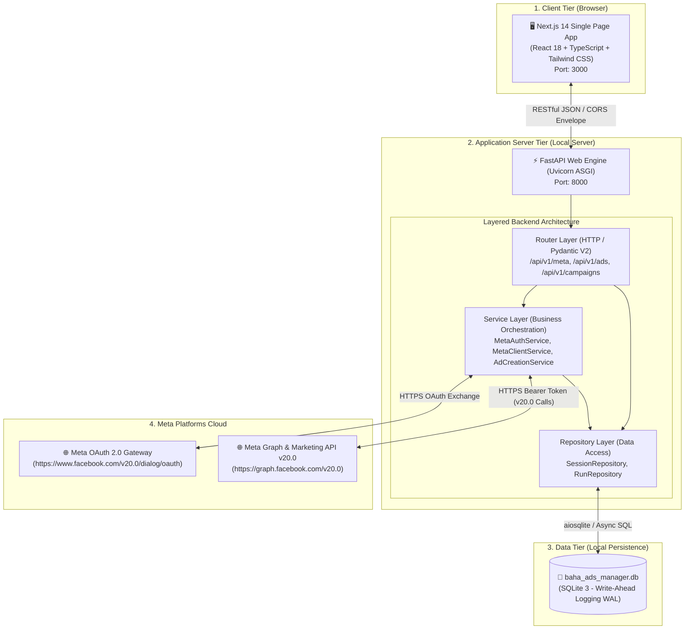
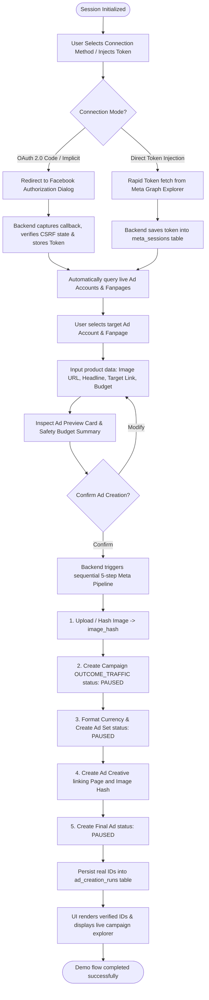
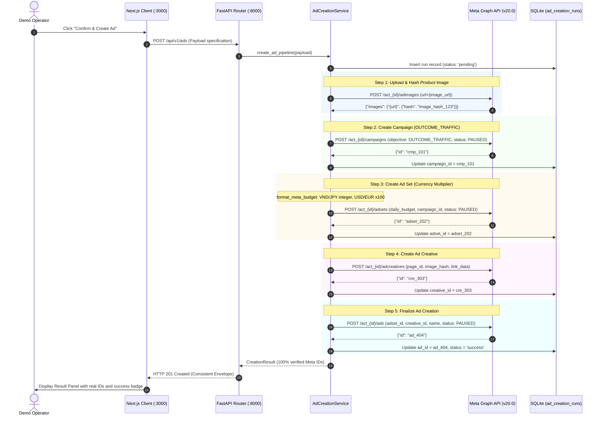
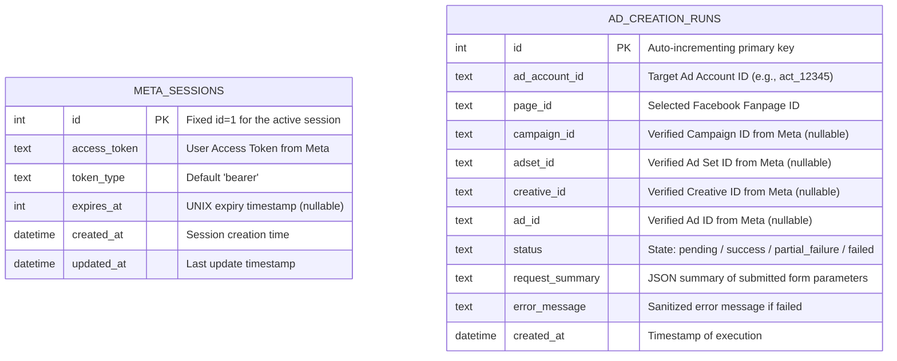

# BAHA Ads Manager

<div align="center">

**Full-Stack Platform for Automating & Orchestrating Ad Campaigns via Meta Marketing API v20.0**

[](README.md)
[](README.vi.md)

[](https://fastapi.tiangolo.com)
[](https://nextjs.org)
[](https://www.typescriptlang.org)
[](https://tailwindcss.com)
[](https://www.sqlite.org)
[](https://developers.facebook.com)
[](backend/tests)
[](LICENSE)

[Overview](#1-project-overview) • [Architecture & Diagrams](#2-system-architecture--technical-diagrams) • [Core Features](#3-core-features) • [Repository Structure](#4-standardized-repository-structure) • [Installation & Setup](#5-installation--quickstart-guide) • [Demo Walkthrough](#6-live-demo-walkthrough-2-hour-mvp) • [API Contract](#7-api-contract-specification-v1) • [3-Layer Documentation](#8-3-layer-documentation-framework)

</div>

---

## 1. Project Overview

**BAHA Ads Manager** is a dedicated full-stack web application designed to connect directly with Meta/Facebook, discover accessible Ad Accounts and Fanpages, and orchestrate automated product advertising creation through the **official Meta Marketing API (v20.0)**, delivering verified, authentic results in a clean, modern interface.

### 🎯 Core Mission & Invariants
- **Rapid End-to-End Execution**: A fully functional, production-standard demonstration deliverable completed within a strict **2-hour** development scope.
- **100% Real API Data (Zero Simulations / Mocks)**: Every asset listed (Ad Accounts, Pages, Campaigns) and every resource created (`campaign_id`, `adset_id`, `creative_id`, `ad_id`) is retrieved and generated live from Meta Platforms servers.
- **Safety-First Invariant (`PAUSED` Default)**: All newly created campaigns, ad sets, and ads are strictly initialized in the **`PAUSED`** state, completely eliminating the risk of accidental financial expenditure prior to manual review on Meta Ads Manager.
- **Token Isolation & Server-Side Security**: User access tokens and application secrets are strictly confined to the backend service (stored in a local SQLite database); they are never leaked to client-side bundles or runtime logs.
- **Partial Failure Resilience**: When any step within the sequential creation pipeline encounters an error (e.g., target URL policy violation), the system preserves and reports all previously created upstream IDs, facilitating immediate diagnosis without hanging or generating duplicates.

---

## 2. System Architecture & Technical Diagrams

The architecture adheres to a **minimalist 2-tier Client-Server pattern (Decoupled Single-Page Web App + Headless FastAPI Server)**. It deliberately foregoes distributed messaging queues (Celery/RabbitMQ), external cache layers (Redis), or cloud object storage (S3) to maximize local execution reliability and zero-config deployment.

### 2.1. High-Level Topology



---

### 2.2. End-to-End Business Workflow



---

### 2.3. Sequential 5-Step Meta Creation Pipeline (Sequence Diagram)

The backend synchronously coordinates five sequential calls against Meta Marketing API v20.0, handling currency conversion and isolating partial failures:



---

### 2.4. Data Architecture & Schema Specification (ERD)

The internal SQLite schema is deliberately simplified to **2 independent tables** with automatic migration on startup:



---

## 3. Core Features

| Subsystem | Feature | Technical Details |
| :--- | :--- | :--- |
| **Authentication<br/>(Dual-Mode Auth)** | 🔑 **OAuth 2.0 Code Flow** | Production flow: backend generates secure CSRF `state`, exchanges authorization `code` for a User Access Token. |
| | 🌐 **OAuth Implicit Bridge** | When an application only has `App ID` without `App Secret`, a lightweight client-side bridge captures `#access_token` from the URL hash. |
| | ⚡ **Direct Token Injection** | One-click direct token intake from [Meta Graph API Explorer](https://developers.facebook.com/tools/explorer/), guaranteeing 100% demo success by bypassing Facebook password prompts on client machines. |
| **Asset Ingestion<br/>(Discovery)** | 🏢 **Accounts & Pages** | Real-time discovery of manageable Ad Accounts (`/me/adaccounts`) and Facebook Fanpages (`/me/accounts`), displaying account currency, timezone, and numeric IDs. |
| **Campaign Form<br/>(Smart Form)** | 📝 **Standardized Input** | Fast configuration: Campaign Name, Product Image URL, Landing Page URL, Headline, Primary Text, Call-to-Action (`LEARN_MORE`, `SHOP_NOW`...). |
| | 💵 **Currency Multiplier** | Automatically scales decimal currencies by 100 (USD, EUR, SGD...) while preserving integers for zero-decimal currencies (VND, JPY, KRW) to protect budgets. |
| **Visual Preview<br/>(Ad Preview)** | 📱 **Mobile Feed Card** | High-fidelity interactive preview of Facebook Mobile Single Image Link Ad before calling live APIs. |
| | 🛡️ **Safety Guardrails** | Clear visual alerts guaranteeing `OUTCOME_TRAFFIC` objective and forced `PAUSED` status. |
| **Orchestration<br/>(Pipeline Execution)** | 🔄 **5-Step Sequential Call** | Ordered execution: Image Hash $\rightarrow$ Campaign $\rightarrow$ Ad Set $\rightarrow$ Creative $\rightarrow$ Final Ad. |
| | 🛡️ **Partial Failure Recovery** | Preserves all intermediate IDs created prior to any step failure, reporting sanitized errors without hanging. |
| **Explorer<br/>(Campaign Management)** | 📊 **Live Campaign Table** | Real-time query of active/paused campaigns on the target Ad Account (`/act_{id}/campaigns`) with status indicators and quick refresh. |
| **Visual Artifacts<br/>(Design Showcase)** | 🎨 **Standalone Showcase** | Self-contained HTML interactive slide showcase at `docs/views/mvp-showcase.html` with keyboard navigation (`←` `→`). |

---

## 4. Standardized Repository Structure

The repository enforces strict separation of concerns, maintaining complete isolation between Backend and Frontend environments:

```
E:\MyProject\BAHA\
├── backend/                           # FastAPI Application Root (Python)
│   ├── app/
│   │   ├── api/v1/endpoints/          # API Routers (/health, /meta_auth, /meta_assets, /ads)
│   │   ├── core/                      # Configuration (config.py) & SQLite init (database.py)
│   │   ├── middlewares/               # Request ID, Access Logging, Error Handler, CORS
│   │   ├── repositories/              # SQLite Data Access Layer (SessionRepo, RunRepo)
│   │   ├── schemas/                   # Pydantic V2 Request/Response Envelopes
│   │   ├── services/                  # MetaAuthService, MetaClientService, AdCreationService
│   │   └── main.py                    # FastAPI Factory & Middleware Assembly
│   ├── tests/                         # Automated test suite (18 Pytest unit/integration tests)
│   ├── .venv/                         # Isolated Virtual Environment (Python 3.11+)
│   ├── baha_ads_manager.db            # Local SQLite database file (WAL mode)
│   ├── pyproject.toml                 # Dependencies & test configurations (Ruff, Pytest)
│   └── .env.example                   # Environment configuration template
│
├── frontend/                          # Next.js Application Root (TypeScript)
│   ├── src/
│   │   ├── app/                       # App Router: layout.tsx, page.tsx, globals.css
│   │   ├── components/                # Modular UI Components (Soft Clean Cards design)
│   │   │   ├── Header.tsx             # Navigation header & live connection status
│   │   │   ├── ConnectCard.tsx        # OAuth connect card & Direct Token modal
│   │   │   ├── AssetSelector.tsx      # Ad Account & Fanpage selector dropdowns
│   │   │   ├── AdForm.tsx             # Product Ad creation form with currency logic
│   │   │   ├── AdPreviewCard.tsx      # Mobile Facebook Link Ad simulation preview
│   │   │   ├── ResultPanel.tsx        # Real IDs display & Partial Failure report panel
│   │   │   └── CampaignTable.tsx      # Live campaign table querying Meta API
│   │   ├── services/api.ts            # Client API wrapper enforcing Consistent Envelopes
│   │   └── types/index.ts             # Shared TypeScript type definitions
│   ├── package.json                   # Dependencies: Next.js 14, React 18, Tailwind, Lucide
│   └── tailwind.config.js             # Design System tokens (radius 28px, custom shadows)
│
├── docs/                              # 3-Layer Documentation Framework
│   ├── business/                      # Business Layer (brd.md, roadmap.md, glossary.md, stakeholders.md)
│   ├── architecture/                  # Architecture Layer (01 to 14, ADR-001)
│   ├── implementation/release-1/      # Implementation Layer (prd.md, srs.md, technical-design.md, backlog, qa)
│   │   ├── api/v1.md                  # Comprehensive API Contract for 11 endpoints
│   │   ├── backlog/stories/           # 8 User Stories (US-001 to US-008, 29 Acceptance Criteria)
│   │   └── meta-connection-lessons.md # Real-world Meta API integration lessons learned
│   ├── views/                         # Visual Views Layer (Self-contained HTML Artifacts)
│   │   └── mvp-showcase.html          # Interactive presentation slide deck
│   └── requirement/                   # Original requirements documentation
│
├── tasks/                             # Engineering Task Tracking
│   ├── todo.md                        # Task execution checklist
│   └── lessons.md                     # Agent engineering lessons learned
│
├── AGENTS.md                          # AI Coding Agent behavioral specifications
├── LICENSE                            # Open-source license (Apache License 2.0)
├── README.md                          # Official documentation in English (this file)
└── README.vi.md                       # Official documentation in Vietnamese
```

---

## 5. Installation & Quickstart Guide

### 5.1. Prerequisites
- **Operating System**: Windows 10/11, macOS, or Linux.
- **Python**: Version `3.11` or higher (Recommended: `uv` or standard `python -m venv`).
- **Node.js**: Version `18.18` or `20.x` LTS (with `npm`).
- **Meta Account**: A Facebook account with administrator access to at least 1 Ad Account and 1 Fanpage on [developers.facebook.com](https://developers.facebook.com).

---

### 5.2. Step 1: Backend Setup & Execution

1. Open your terminal and navigate to the `backend` directory:
   ```bash
   cd backend
   ```

2. Create and activate an isolated Python virtual environment:
   ```powershell
   # Using uv (fast & clean):
   uv venv .venv
   .\.venv\Scripts\activate

   # Or standard python:
   python -m venv .venv
   .\.venv\Scripts\activate
   ```

3. Install required packages:
   ```powershell
   pip install -r requirements.txt
   # Or install via pyproject.toml:
   pip install -e ".[dev]"
   ```

4. Configure environment variables (`.env`):
   Copy `.env.example` to `backend/.env`:
   ```dotenv
   ENVIRONMENT=development
   HOST=0.0.0.0
   PORT=8000
   BACKEND_CORS_ORIGINS=["http://localhost:3000","http://127.0.0.1:3000"]
   DATABASE_PATH=baha_ads_manager.db

   # Meta Marketing API Credentials (v20.0)
   META_APP_ID=your_meta_app_id
   META_APP_SECRET=your_meta_app_secret
   META_REDIRECT_URI=http://localhost:8000/api/meta/callback
   META_API_VERSION=v20.0
   FRONTEND_URL=http://localhost:3000
   META_API_TIMEOUT=30.0
   ```
   > 💡 **Quick Demo Tip**: If you are using the Graph API Explorer Token method, you can retain placeholder values in `.env` and inject the token directly through the UI.

5. Start the Backend API server:
   ```powershell
   .\.venv\Scripts\uvicorn.exe app.main:app --host 0.0.0.0 --port 8000 --reload
   ```
   - **API Base URL**: `http://localhost:8000`
   - **Interactive OpenAPI Docs**: `http://localhost:8000/docs`
   - **Health Check**: `http://localhost:8000/health`

---

### 5.3. Step 2: Frontend Setup & Execution

1. Open a new terminal window and navigate to the `frontend` directory:
   ```bash
   cd frontend
   ```

2. Install local project dependencies:
   ```bash
   npm install
   ```

3. Start the Next.js development server:
   ```bash
   npm run dev
   ```

4. Open your browser and navigate to:
   ```
   http://localhost:3000
   ```

---

## 6. Live Demo Walkthrough (2-Hour MVP)

Follow these steps to conduct an end-to-end demonstration verifying real-time Meta Marketing API integration:

```
┌──────────────────┐     ┌──────────────────┐     ┌──────────────────┐     ┌──────────────────┐
│ 1. Connect Meta  │ ──> │ 2. Select Assets │ ──> │ 3. Fill Form &   │ ──> │ 4. Create & View │
│   (OAuth/Explorer│     │    (Account/Page)│     │    Verify Preview│     │    Real Meta IDs │
└──────────────────┘     └──────────────────┘     └──────────────────┘     └──────────────────┘
```

1. **Step 1: Connect Meta Account**
   - Navigate to `http://localhost:3000`. The system will automatically check backend health and existing sessions.
   - **Method A (Recommended for live customer demos)**: Open [Meta Graph API Explorer](https://developers.facebook.com/tools/explorer/), select your app, enable permissions (`ads_management`, `ads_read`, `pages_read_engagement`, `pages_manage_ads`, `public_profile`), and generate an Access Token. In the BAHA UI, click **"Nạp token trực tiếp từ Graph API Explorer"**, paste the `EAAB...` token, and click **Lưu phiên**.
   - **Method B (Standard OAuth)**: Click **"Connect Facebook ngay"** to initiate the Facebook Login dialog.
2. **Step 2: Select Ad Account & Fanpage**
   - Once connected, the app fetches all accessible assets from Meta.
   - Select your target Ad Account (e.g., `act_120210...`) and your brand Fanpage (e.g., `BAHA Fashion`).
3. **Step 3: Fill Product Ad Details**
   - Switch to the **"Tạo Quảng Cáo"** (Create Ad) tab.
   - Enter your campaign parameters:
     - **Campaign Name**: `BAHA Summer Polo Campaign 2026`
     - **Image URL**: Direct public image URL from a CDN or e-commerce catalog.
     - **Landing Page URL**: Product destination URL (e.g., `https://baha.vn/products/polo`).
     - **Headline**: `Premium Breathable Polo Shirt - 20% Off Today`
     - **Primary Text**: `4-way stretch fabric with anti-odor technology. Shop now for exclusive launch discounts!`
     - **Daily Budget**: `100,000` (for VND accounts) or `10` (for USD accounts).
4. **Step 4: Inspect Preview & Safety Guardrails**
   - Check the **Ad Preview Card** on the right side of the screen to preview the mobile feed appearance.
   - Review the safety alert box confirming the mandatory `PAUSED` state.
   - Click **"Xác nhận tạo quảng cáo ngay"**.
5. **Step 5: Verify Live Meta IDs & Campaign Table**
   - The backend coordinates the 5 API steps in 3–8 seconds.
   - The **Creation Result Panel** displays the 4 authentic Meta resource IDs:
     - `campaign_id`: Live Campaign ID on Meta
     - `adset_id`: Live Ad Set ID
     - `creative_id`: Live Creative ID
     - `ad_id`: Final Ad ID
   - Switch to the **"Chiến Dịch"** (Campaigns) tab to view the newly created campaign listed in the real-time query from Meta.

---

## 7. API Contract Specification (v1)

The system adheres strictly to the **7 standardized REST design patterns** (`api-design-patterns`), offering explicit versioning (`/api/v1`), backward-compatible root aliases (`/api`), and unified **Consistent Response Envelopes**.

### 7.1. Quick Endpoint Reference

| Method | Endpoint Path | Function & Scope | Design Pattern | Auth |
|:---:|:---|:---|:---:|:---:|
| `GET` | `/health` | Check backend service & SQLite file health | Consistent Response | Public |
| `GET` | `/api/v1/meta/connect` | Generate OAuth login URL with CSRF state | State Token | Public |
| `GET` | `/api/v1/meta/callback` | Exchange OAuth code for User Access Token | Code Exchange | Public |
| `POST` | `/api/v1/meta/token-callback` | Receive token from URL hash fragment (Implicit Flow) | Token Ingestion | Public |
| `POST` | `/api/v1/meta/direct-token` | Ingest token directly from Graph API Explorer | Session Setup | Public |
| `GET` | `/api/v1/meta/status` | Query active Meta connection status | Session Status | Public |
| `POST` | `/api/v1/meta/disconnect` | Purge current session from SQLite `meta_sessions` | Session Purge | Public |
| `GET` | `/api/v1/meta/ad-accounts` | Fetch all accessible Ad Accounts | Field Selection | Session |
| `GET` | `/api/v1/meta/pages` | Fetch all manageable Facebook Fanpages | Field Selection | Session |
| `POST` | `/api/v1/ads` | Execute 5-step sequential Meta ad creation | Sequential Pipeline | Session |
| `GET` | `/api/v1/ads/runs/latest` | Retrieve results of the most recent creation run | Consistent Response | Session |
| `GET` | `/api/v1/ads/runs/{id}` | Retrieve specific execution run details by ID | Consistent Response | Session |
| `GET` | `/api/v1/campaigns` | Query live campaigns from the selected Ad Account | Filtering & Pagination | Session |

*(All endpoints above are dual-mounted under `/api/...` for legacy compatibility).*

---

### 7.2. Consistent Response Envelopes

Every API response follows a unified structural contract:

#### Success Envelope:
```json
{
  "success": true,
  "statusCode": 200,
  "message": "Product ad created successfully",
  "data": {
    "runId": 1,
    "status": "success",
    "adAccountId": "act_120210000000001",
    "campaignId": "120210000000002",
    "adsetId": "120210000000003",
    "creativeId": "120210000000004",
    "adId": "120210000000005"
  },
  "meta": {
    "timestamp": "2026-10-17T15:30:00Z",
    "requestId": "req_f81d4fae7dec"
  }
}
```

#### Error Envelope (with Partial Failure Reporting):
```json
{
  "success": false,
  "statusCode": 400,
  "message": "Ad creation failed at step: create_creative",
  "error": {
    "code": "META_CREATIVE_POLICY_VIOLATION",
    "failedStep": "create_creative",
    "details": [
      {
        "field": "linkUrl",
        "issue": "Destination landing page violates Meta Advertising Standards."
      }
    ]
  },
  "meta": {
    "timestamp": "2026-10-17T15:31:00Z",
    "requestId": "req_8b21ca09d11e"
  }
}
```

---

## 8. Quality Assurance & Automated Testing

The codebase adheres strictly to Robert C. Martin's Clean Code principles, featuring automated test suites verifying zero regressions across all core flows:

### 8.1. Backend Test Suite (Pytest)
The test suite consists of **18 automated test cases** located in `backend/tests/`:
- `test_health.py`: Validates service health and SQLite connectivity.
- `test_meta_auth.py`: Tests OAuth URL generation, CSRF verification, callback parsing, and direct token injection.
- `test_meta_assets.py`: Validates real-time retrieval of Ad Accounts and Fanpages.
- `test_currency_and_security.py`: Tests budget currency multiplier accuracy (VND vs USD) and sensitive token sanitization.
- `test_ads.py`: Simulates the complete 5-step pipeline, error handling, partial failure recovery, and database logging.

Run tests:
```powershell
cd backend
.\.venv\Scripts\pytest.exe -v
```

Execution output:
```text
tests/test_ads.py ......                                [ 33%]
tests/test_currency_and_security.py ...                 [ 50%]
tests/test_health.py .                                  [ 55%]
tests/test_meta_assets.py ...                           [ 72%]
tests/test_meta_auth.py .....                           [100%]

============================= 18 passed in 2.13s ==============================
```

### 8.2. Linting & Static Code Analysis
```powershell
# Backend code quality check with Ruff:
cd backend
.\.venv\Scripts\ruff.exe check .

# Frontend TypeScript & React linting:
cd frontend
npm run lint
```

---

## 9. 3-Layer Documentation Framework

The project documentation is structured according to the **3-Layer Documentation Architecture** to guarantee a Single Source of Truth:

| Documentation Layer | Directory | Purpose & Key Documents |
|:---|:---|:---|
| **1. Business Layer** | [`docs/business/`](docs/business/) | Strategic objectives, business constraints, and market domain.<br/>• [`brd.md`](docs/business/brd.md): Business Requirements Document.<br/>• [`roadmap.md`](docs/business/roadmap.md): Strategic product roadmap.<br/>• [`glossary.md`](docs/business/glossary.md): Standardized AdTech terminology.<br/>• [`stakeholders.md`](docs/business/stakeholders.md): Stakeholder engagement matrix. |
| **2. Architecture Layer** | [`docs/architecture/`](docs/architecture/) | High-level engineering blueprints, boundaries, and system invariants.<br/>• [`01-system-context.md`](docs/architecture/01-system-context.md): System boundary and actor definition.<br/>• [`02-high-level-architecture.md`](docs/architecture/02-high-level-architecture.md): Client-Server topology.<br/>• [`03-service-architecture.md`](docs/architecture/03-service-architecture.md): Router $\rightarrow$ Service $\rightarrow$ Repository layering.<br/>• [`05-data-architecture.md`](docs/architecture/05-data-architecture.md): SQLite schema specifications.<br/>• [`07-security-architecture.md`](docs/architecture/07-security-architecture.md): Token isolation and sanitization standards.<br/>• [`08-integration-architecture.md`](docs/architecture/08-integration-architecture.md): Meta v20.0 integration & envelope standards.<br/>• [`12-design-system.md`](docs/architecture/12-design-system.md) & [`14-design-language.md`](docs/architecture/14-design-language.md): Soft Clean Cards UI language. |
| **3. Implementation Layer** | [`docs/implementation/release-1/`](docs/implementation/release-1/) | Detailed technical blueprints and execution artifacts for Release 1.<br/>• [`prd.md`](docs/implementation/release-1/prd.md): Product Requirements Document with Guardrails.<br/>• [`srs.md`](docs/implementation/release-1/srs.md): Non-Functional Requirements & scale constraints.<br/>• [`technical-design.md`](docs/implementation/release-1/technical-design.md): Sequence diagrams & partial failure recovery.<br/>• [`api/v1.md`](docs/implementation/release-1/api/v1.md): 11-endpoint REST contract specifications.<br/>• [`backlog/story-index.md`](docs/implementation/release-1/backlog/story-index.md): 8 User Stories with 29 Acceptance Criteria.<br/>• [`qa/test-cases.md`](docs/implementation/release-1/qa/test-cases.md): 20 comprehensive QA acceptance test cases.<br/>• [`meta-connection-lessons.md`](docs/implementation/release-1/meta-connection-lessons.md): Practical Meta API connection lessons. |
| **4. Visual Views Layer** | [`docs/views/`](docs/views/) | Standalone interactive HTML presentation artifacts.<br/>• [`mvp-showcase.html`](docs/views/mvp-showcase.html): Interactive Soft Clean Cards slide deck for architecture walkthroughs. |

---

## 10. Practical Meta Marketing API Insights & Lessons Learned

Key practical takeaways derived from live integration testing at [meta-connection-lessons.md](docs/implementation/release-1/meta-connection-lessons.md):

1. **Meta App Secret Password Prompt Barrier**:
   - On partner or customer machines, viewing the `App Secret` in Meta Developer Settings strictly requires re-entering the personal Facebook account password.
   - **Remedy**: Incorporating a **Direct Token Injection** mechanism using tokens generated from the **Meta Graph API Explorer** eliminates the need for customer password sharing, guaranteeing zero friction during live demos.
2. **Mandatory Permission Scopes**:
   - Asset ingestion: `public_profile`, `ads_read`, `pages_show_list`, `pages_read_engagement`.
   - Campaign creation: `ads_management`, `pages_manage_ads`.
3. **Currency Multiplier Calculation**:
   - Meta requires daily budget values in cents for major global currencies (`$10` $\rightarrow$ `1000`), but as whole integers for zero-decimal currencies (`100,000 VND` $\rightarrow$ `100000`). Applying cent multipliers to VND results in 100x over-budget creation.
4. **Ad Account Payment Health**:
   - The selected Ad Account must have a verified payment method attached or exist as an authorized sandbox test account; otherwise, Meta rejects creation at Step 3 (Ad Set) or Step 5 (Ad).

---

## 11. License

This project is licensed under the **Apache License 2.0**. See the [LICENSE](LICENSE) file for complete details.

---

<div align="center">
  <b>BAHA Ads Manager</b> — Engineered with pair-programming support from <b>Google Antigravity</b>
</div>
