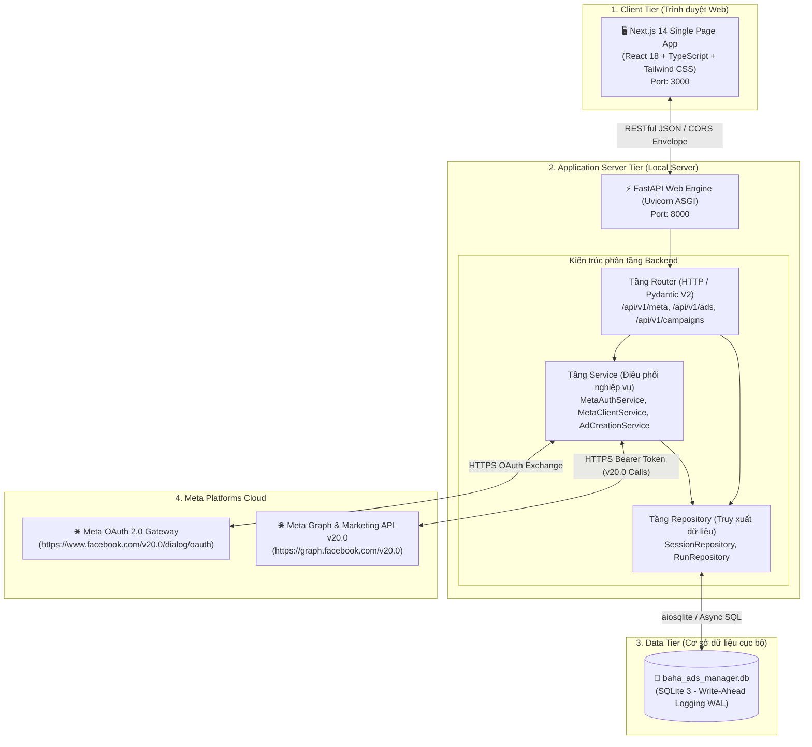
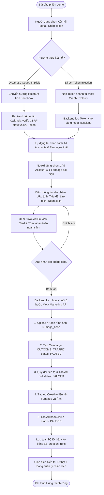
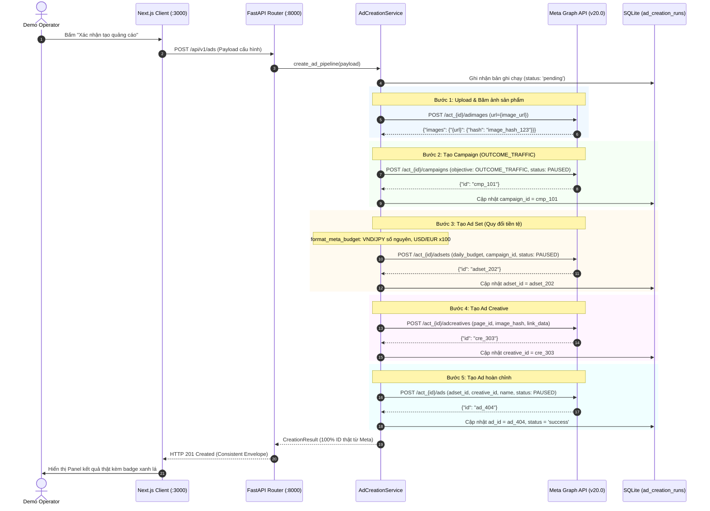
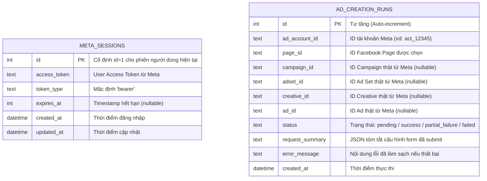

# BAHA Ads Manager

<div align="center">

**Nền tảng Full-Stack Tự động hóa Tạo & Điều phối Chiến dịch Quảng cáo qua Meta Marketing API v20.0**

[](README.md)
[](README.vi.md)

[](https://fastapi.tiangolo.com)
[](https://nextjs.org)
[](https://www.typescriptlang.org)
[](https://tailwindcss.com)
[](https://www.sqlite.org)
[](https://developers.facebook.com)
[](backend/tests)
[](LICENSE)

[Tổng quan](#1-tổng-quan-dự-án) • [Kiến trúc & Sơ đồ](#2-kiến-trúc-hệ-thống--sơ-đồ-kỹ-thuật) • [Tính năng](#3-tính-năng-cốt-lõi) • [Cấu trúc mã nguồn](#4-cấu-trúc-thư-mục-chuẩn-hóa) • [Hướng dẫn cài đặt](#5-hướng-dẫn-cài-đặt--khởi-chạy) • [Kịch bản Demo](#6-kịch-bản-thao-tác-demo) • [Đặc tả API](#7-đặc-tả-api-contract-v1) • [Tài liệu 3 tầng](#8-hệ-thống-tài-liệu-3-tầng)

</div>

---

## 1. Tổng quan dự án

**BAHA Ads Manager** là giải pháp phần mềm chuyên biệt phục vụ việc kết nối trực tiếp tài khoản Meta/Facebook, lựa chọn tài khoản quảng cáo và Fanpage, tự động điều phối chuỗi tạo quảng cáo sản phẩm thông qua **Meta Marketing API chính thức (v20.0)**, đồng thời hiển thị và kiểm chứng kết quả thực tế trên giao diện trực quan.

### 🎯 Mục tiêu cốt lõi
- **Tốc độ & Thực chiến**: Hoàn thiện toàn bộ luồng nghiệp vụ end-to-end có thể demo thực tế trong khoảng **2 giờ**.
- **100% API thật (No Simulation/Mocks)**: Mọi dữ liệu tài khoản, danh sách Fanpage, chiến dịch và kết quả trả về (`campaign_id`, `adset_id`, `creative_id`, `ad_id`) đều được truy vấn và tạo trực tiếp trên máy chủ Meta Platforms.
- **An toàn ngân sách tuyệt đối (Safety-First Invariant)**: Mọi chiến dịch, nhóm quảng cáo và mẫu quảng cáo tạo mới luôn được khóa cứng ở trạng thái **`PAUSED`**, triệt tiêu 100% rủi ro tự động chi tiêu trước khi người dùng chủ động xét duyệt trên Meta Ads Manager.
- **Bảo mật & Cô lập Token**: Token người dùng (`access_token`) và khóa bí mật (`app_secret`) được xử lý và lưu trữ hoàn toàn tại backend (SQLite cục bộ), tuyệt đối không để lộ ra phía client hay ghi vào console log.
- **Khả năng chịu lỗi một phần (Partial Failure Resilience)**: Khi một bước trong chuỗi tạo gặp lỗi (ví dụ chính sách link sản phẩm), hệ thống vẫn bảo tồn các tài nguyên đã tạo ở các bước trước đó, hỗ trợ truy vết chính xác nguyên nhân mà không treo tiến trình hay tạo trùng lặp.

---

## 2. Kiến trúc hệ thống & Sơ đồ kỹ thuật

Hệ thống được tổ chức theo mô hình **Client-Server 2 tầng tối giản (Decoupled Single-Page Web App + Headless FastAPI Server)**, loại bỏ các thành phần phức tạp không cần thiết (không dùng Message Queue, không dùng Cloud Storage, không dùng Redis) để tối ưu độ tin cậy và tốc độ thực thi cục bộ.

### 2.1. Sơ đồ kiến trúc tổng thể (High-Level Topology)



---

### 2.2. Sơ đồ luồng nghiệp vụ End-to-End



---

### 2.3. Sơ đồ tuần tự Chuỗi 5 Bước tạo Quảng cáo Meta (Sequential Creation Pipeline)

Backend thực hiện chuỗi 5 lời gọi Meta Marketing API một cách tuần tự, ghi nhận chính xác trạng thái từng bước và đảm bảo cơ chế **Partial Failure**:



---

### 2.4. Sơ đồ thực thể dữ liệu (ERD)

Cơ sở dữ liệu SQLite cục bộ được tối giản thành **2 bảng độc lập**, tự động khởi tạo khi backend khởi động (Zero-Config DDL):



---

## 3. Tính năng cốt lõi

| Phân hệ | Tính năng | Mô tả chi tiết |
| :--- | :--- | :--- |
| **Xác thực Đa kênh<br/>(Dual-Mode Auth)** | 🔑 **OAuth 2.0 Code Flow** | Luồng chuẩn production: backend sinh URL với tham số `state` chống CSRF, nhận mã ủy quyền `code` và đổi lấy User Access Token. |
| | 🌐 **OAuth Implicit Bridge** | Khi Meta App chỉ có `App ID` mà chưa có `App Secret`, backend hỗ trợ cầu nối HTML JavaScript đọc `#access_token` từ URL hash fragment. |
| | ⚡ **Direct Token Injection** | Khả năng nạp trực tiếp Access Token lấy từ [Meta Graph API Explorer](https://developers.facebook.com/tools/explorer/) chỉ với 1 thao tác copy-paste, đảm bảo buổi demo live 100% thành công không bị chặn bởi bảo mật mật khẩu của tài khoản khách hàng. |
| **Quản lý Tài sản số<br/>(Asset Discovery)** | 🏢 **Ad Accounts & Fanpages** | Tự động đồng bộ danh sách Ad Accounts (`/me/adaccounts`) và Facebook Fanpages (`/me/accounts`) kèm thông tin tiền tệ (`currency`), múi giờ và ID số thực tế. |
| **Tạo Quảng cáo<br/>(Smart Ad Form)** | 📝 **Chuẩn hóa Đầu vào** | Hỗ trợ cấu hình nhanh: Tên chiến dịch, URL ảnh sản phẩm, URL trang đích (landing page), Tiêu đề (Headline), Văn bản chính (Primary Text), Nút kêu gọi hành động (CTA: `LEARN_MORE`, `SHOP_NOW`...). |
| | 💵 **Currency Multiplier Auto** | Tự động nhân 100 đối với đơn vị tiền tệ có cent (USD, EUR, SGD...) và giữ nguyên số nguyên đối với đơn vị tiền tệ không có cent (VND, JPY, KRW), tránh lỗi chi tiêu sai lệch quy mô. |
| **Xem trước Trực quan<br/>(Ad Preview)** | 📱 **Mobile Feed Card** | Mô phỏng chính xác giao diện bài quảng cáo dạng thẻ liên kết (Single Image Link Ad) trên ứng dụng Facebook Mobile trước khi bấm tạo. |
| | 🛡️ **Tóm tắt An toàn** | Cảnh báo rõ ràng: Mục tiêu cố định `OUTCOME_TRAFFIC`, trạng thái bắt buộc `PAUSED`, và ngân sách dự kiến tiêu dùng. |
| **Điều phối API Meta<br/>(Pipeline Execution)** | 🔄 **5-Step Sequential Calls** | Tự động điều phối thứ tự 5 lời gọi: Băm ảnh $\rightarrow$ Tạo Campaign $\rightarrow$ Tạo Ad Set $\rightarrow$ Tạo Creative $\rightarrow$ Tạo Ad. |
| | 🛡️ **Partial Failure Handling** | Nếu bị gián đoạn ở bước bất kỳ, lưu giữ các ID đã tạo thành công trước đó vào SQLite và thông báo rõ bước gặp lỗi kèm nguyên nhân đã làm sạch. |
| **Quản lý Chiến dịch<br/>(Campaign Explorer)** | 📊 **Live Campaign Table** | Truy vấn trực tiếp danh sách chiến dịch đang có trên Ad Account thật (`/act_{id}/campaigns`), hiển thị tên, ID, trạng thái, mục tiêu và thời gian cập nhật. |
| **Tài liệu Trực quan<br/>(Visual Showcase)** | 🎨 **Standalone Showcase** | Tệp HTML trình diễn tương tác độc lập tại `docs/views/mvp-showcase.html` hỗ trợ chuyển slide thuyết trình tổng kết toàn diện kiến trúc dự án. |

---

## 4. Cấu trúc thư mục chuẩn hóa

Dự án tuân thủ nghiêm ngặt **Kiến trúc phân tầng 3 lớp (3-Layer Architecture)** và quy tắc bất biến về cô lập môi trường:

```
E:\MyProject\BAHA\
├── backend/                           # Ứng dụng Backend (FastAPI Python)
│   ├── app/
│   │   ├── api/v1/endpoints/          # API Routers (/health, /meta_auth, /meta_assets, /ads)
│   │   ├── core/                      # Cấu hình môi trường (config.py) & SQLite init (database.py)
│   │   ├── middlewares/               # Request ID, Logging, Safe Error Handling, CORS
│   │   ├── repositories/              # Tầng tương tác dữ liệu (SessionRepo, RunRepo)
│   │   ├── schemas/                   # Pydantic V2 Models & Consistent Response Envelope
│   │   ├── services/                  # MetaAuthService, MetaClientService, AdCreationService
│   │   └── main.py                    # Khởi tạo FastAPI App & Middleware Registration
│   ├── tests/                         # Bộ kiểm thử tự động 18 test cases (Pytest)
│   ├── .venv/                         # Virtual Environment cô lập (Python 3.11+)
│   ├── baha_ads_manager.db            # Cơ sở dữ liệu SQLite cục bộ (chế độ WAL)
│   ├── pyproject.toml                 # Định nghĩa dependencies & công cụ kiểm thử (Ruff, Pytest)
│   └── .env.example                   # Mẫu biến môi trường cấu hình backend
│
├── frontend/                          # Ứng dụng Frontend (Next.js 14 App Router)
│   ├── src/
│   │   ├── app/                       # App Router: layout.tsx, page.tsx, globals.css
│   │   ├── components/                # Modular React Components
│   │   │   ├── Header.tsx             # Thanh điều hướng trên cùng & trạng thái kết nối
│   │   │   ├── ConnectCard.tsx        # Card kết nối Meta OAuth & Direct Token Input
│   │   │   ├── AssetSelector.tsx      # Dropdown lựa chọn Ad Account và Fanpage
│   │   │   ├── AdForm.tsx             # Biểu mẫu nhập thông tin quảng cáo sản phẩm
│   │   │   ├── AdPreviewCard.tsx      # Trình mô phỏng xem trước Facebook Ad di động
│   │   │   ├── ResultPanel.tsx        # Bảng hiển thị ID thật & chi tiết lỗi một phần
│   │   │   └── CampaignTable.tsx      # Bảng danh sách chiến dịch thật trên Ad Account
│   │   ├── services/api.ts            # Client gọi API Backend với chuẩn phong bì thống nhất
│   │   └── types/index.ts             # Định nghĩa kiểu dữ liệu TypeScript dùng chung
│   ├── package.json                   # Dependencies: Next.js 14, React 18, Tailwind, Lucide
│   └── tailwind.config.js             # Cấu hình Design System Soft Clean Cards (radius 28px)
│
├── docs/                              # Hệ thống tài liệu dự án 3 tầng chuẩn mực
│   ├── business/                      # Tầng Nghiệp vụ (brd.md, roadmap.md, glossary.md, stakeholders.md)
│   ├── architecture/                  # Tầng Kiến trúc cốt lõi (01 đến 14, ADR-001)
│   ├── implementation/release-1/      # Tầng Thực thi (prd.md, srs.md, technical-design.md, backlog, qa)
│   │   ├── api/v1.md                  # Hợp đồng API Contract chi tiết 11 endpoints
│   │   ├── backlog/stories/           # 8 User Stories (US-001 đến US-008, 29 Acceptance Criteria)
│   │   └── meta-connection-lessons.md # Đúc kết kinh nghiệm thực chiến kết nối Meta API
│   ├── views/                         # Tầng Trực quan (Tệp HTML tương tác độc lập)
│   │   └── mvp-showcase.html          # Slide thuyết trình & Sơ đồ kiến trúc tương tác Soft Clean Cards
│   └── requirement/                   # Yêu cầu đầu vào gốc (BAHA_Ads_Manager_MVP_Requirements.md)
│
├── tasks/                             # Quản lý tiến độ nhiệm vụ & bài học
│   ├── todo.md                        # Tiến độ từng đầu việc kỹ thuật
│   └── lessons.md                     # Bài học vận hành của Agent
│
├── AGENTS.md                          # Hồ sơ điều khiển và quy chuẩn cho AI Coding Agent
├── LICENSE                            # Giấy phép phần mềm mã nguồn mở (Apache License 2.0)
├── README.md                          # Tài liệu chính thức (Tiếng Anh)
└── README.vi.md                       # Tài liệu chính thức (Tiếng Việt - tệp này)
```

---

## 5. Hướng dẫn cài đặt & Khởi chạy

### 5.1. Yêu cầu môi trường (Prerequisites)
- **Hệ điều hành**: Windows 10/11, macOS, hoặc Linux.
- **Python**: Phiên bản `3.11` trở lên (Khuyến nghị dùng `uv` hoặc `venv` tiêu chuẩn).
- **Node.js**: Phiên bản `18.18` hoặc `20.x` LTS (kèm `npm`).
- **Tài khoản Meta**: Tài khoản Facebook có quyền truy cập vào tối thiểu 1 Ad Account và 1 Fanpage trên [Meta Business Suite](https://business.facebook.com) hoặc [developers.facebook.com](https://developers.facebook.com).

---

### 5.2. Bước 1: Thiết lập & Khởi chạy Backend

1. Mở terminal và di chuyển vào thư mục `backend`:
   ```bash
   cd backend
   ```

2. Khởi tạo và kích hoạt môi trường ảo Python cục bộ (bảo đảm tính cô lập):
   ```powershell
   # Dùng uv (nhanh và tự động cô lập):
   uv venv .venv
   .\.venv\Scripts\activate

   # Hoặc dùng python chuẩn:
   python -m venv .venv
   .\.venv\Scripts\activate
   ```

3. Cài đặt các thư viện cần thiết:
   ```powershell
   pip install -r requirements.txt
   # Hoặc cài đặt qua pyproject.toml:
   pip install -e ".[dev]"
   ```

4. Cấu hình tệp biến môi trường `.env`:
   Tạo tệp `backend/.env` từ tệp mẫu `.env.example`:
   ```dotenv
   ENVIRONMENT=development
   HOST=0.0.0.0
   PORT=8000
   BACKEND_CORS_ORIGINS=["http://localhost:3000","http://127.0.0.1:3000"]
   DATABASE_PATH=baha_ads_manager.db

   # Meta Marketing API Credentials (v20.0)
   META_APP_ID=your_meta_app_id
   META_APP_SECRET=your_meta_app_secret
   META_REDIRECT_URI=http://localhost:8000/api/meta/callback
   META_API_VERSION=v20.0
   FRONTEND_URL=http://localhost:3000
   META_API_TIMEOUT=30.0
   ```
   > 💡 **Mẹo Demo Nhanh**: Nếu chỉ demo lấy token qua Graph API Explorer, bạn có thể giữ nguyên giá trị mẫu trong `.env` và nạp token trực tiếp trên giao diện web.

5. Khởi chạy Backend Server:
   ```powershell
   .\.venv\Scripts\uvicorn.exe app.main:app --host 0.0.0.0 --port 8000 --reload
   ```
   - **Backend API**: `http://localhost:8000`
   - **Tài liệu Swagger UI**: `http://localhost:8000/docs`
   - **Endpoint Health**: `http://localhost:8000/health`

---

### 5.3. Bước 2: Thiết lập & Khởi chạy Frontend

1. Mở một cửa sổ terminal mới và di chuyển vào thư mục `frontend`:
   ```bash
   cd frontend
   ```

2. Cài đặt các gói phụ thuộc nội bộ (`node_modules`):
   ```bash
   npm install
   ```

3. Khởi chạy máy chủ phát triển Next.js:
   ```bash
   npm run dev
   ```

4. Mở trình duyệt web và truy cập:
   ```
   http://localhost:3000
   ```

---

## 6. Kịch bản thao tác Demo (2-Hour Walkthrough)

Dưới đây là các bước thao tác mẫu để hoàn tất luồng demo trọn vẹn từ kết nối đến kiểm tra kết quả thật trên Meta Ads Manager:

```
┌─────────────────┐     ┌──────────────────┐     ┌─────────────────┐     ┌─────────────────┐
│ 1. Kết nối Meta │ ──> │ 2. Chọn Tài sản  │ ──> │ 3. Điền & Xem   │ ──> │ 4. Bấm Tạo &    │
│    (OAuth / EXP)│     │    (Account/Page)│     │    trước Form   │     │    Xem ID thật  │
└─────────────────┘     └──────────────────┘     └─────────────────┘     └─────────────────┘
```

1. **Bước 1: Kết nối tài khoản Meta**
   - Truy cập `http://localhost:3000`. Hệ thống sẽ kiểm tra trạng thái backend và phiên làm việc.
   - **Cách 1 (Nhanh nhất cho buổi demo live)**: Mở [Meta Graph API Explorer](https://developers.facebook.com/tools/explorer/), chọn ứng dụng của bạn, chọn các quyền: `ads_management`, `ads_read`, `pages_read_engagement`, `pages_manage_ads`, `public_profile`, nhấn **Generate Access Token**. Sau đó quay lại giao diện BAHA Ads Manager, nhấn **"Nạp token trực tiếp từ Graph API Explorer"**, dán chuỗi token bắt đầu bằng `EAAB...` và bấm **Lưu phiên**.
   - **Cách 2 (OAuth chuẩn)**: Bấm nút **"Connect Facebook ngay"** để chuyển hướng sang Facebook Login và đồng ý cấp quyền.
2. **Bước 2: Chọn Ad Account & Fanpage**
   - Sau khi kết nối thành công, hệ thống tự động tải danh sách tài khoản quảng cáo và Fanpage.
   - Chọn tài khoản quảng cáo mục tiêu (ví dụ: `act_120210...`) và Fanpage đại diện thương hiệu (ví dụ: `BAHA Fashion`).
3. **Bước 3: Điền biểu mẫu quảng cáo sản phẩm**
   - Chuyển sang tab **"Tạo Quảng Cáo"**.
   - Điền các thông tin:
     - **Tên chiến dịch**: `BAHA Áo Polo Thể Thao Mùa Hè 2026`
     - **URL hình ảnh**: Đường dẫn ảnh sản phẩm công khai (ví dụ từ CDN hoặc trang bán lẻ).
     - **URL trang đích**: Đường dẫn bài viết / sản phẩm (ví dụ: `https://baha.vn/san-pham/ao-polo`).
     - **Tiêu đề**: `Áo Polo Thoáng Khí Cao Cấp - Ưu Đãi 20% Hôm Nay`
     - **Văn bản chính**: `Chất liệu co giãn 4 chiều, kháng khuẩn và khử mùi vượt trội. Mua ngay để nhận ưu đãi!`
     - **Ngân sách ngày**: `100,000` (nếu tài khoản là VND) hoặc `10` (nếu tài khoản là USD).
4. **Bước 4: Xem trước bài quảng cáo & Xác nhận an toàn**
   - Quan sát khung **Xem trước Quảng cáo** bên phải để xem trực quan hiển thị trên mobile feed.
   - Kiểm tra hộp cảnh báo an toàn ngân sách (cam kết trạng thái `PAUSED`).
   - Nhấn nút **"Xác nhận tạo quảng cáo ngay"**.
5. **Bước 5: Nhận kết quả thật & Đối soát trên Meta Ads Manager**
   - Hệ thống thực thi tuần tự 5 bước trong khoảng 3–8 giây.
   - Bảng kết quả **Creation Result** xuất hiện với thông báo thành công và liệt kê đầy đủ 4 ID thật:
     - `campaign_id`: ID chiến dịch tạo trên Meta
     - `adset_id`: ID nhóm quảng cáo
     - `creative_id`: ID mẫu nội dung
     - `ad_id`: ID bài quảng cáo hoàn tất
   - Chuyển sang tab **"Chiến Dịch"** để xem chiến dịch vừa tạo xuất hiện trực tiếp trong danh sách truy vấn từ Meta Marketing API.

---

## 7. Đặc tả API Contract (v1)

Hệ thống áp dụng nghiêm ngặt **7 mẫu thiết kế RESTful chuẩn hóa** (`api-design-patterns`), bao gồm Versioning (`/api/v1`), hỗ trợ Alias tương thích ngược (`/api`), và định dạng phong bì nhất quán (**Consistent Response Envelope**).

### 7.1. Danh mục Endpoints chính

| Phương thức | Đường dẫn Endpoint | Mô tả chức năng | Mẫu thiết kế | Quyền |
|:---:|:---|:---|:---:|:---:|
| `GET` | `/health` | Kiểm tra kết nối Backend & trạng thái file SQLite | Consistent Response | Public |
| `GET` | `/api/v1/meta/connect` | Khởi tạo OAuth URL kèm kiểm tra CSRF state | State Token | Public |
| `GET` | `/api/v1/meta/callback` | Nhận ủy quyền OAuth từ Meta & đổi Access Token | Code Exchange | Public |
| `POST` | `/api/v1/meta/token-callback` | Nhận token từ URL hash fragment (Implicit Flow) | Token Ingestion | Public |
| `POST` | `/api/v1/meta/direct-token` | Nạp token trực tiếp từ Graph API Explorer | Session Setup | Public |
| `GET` | `/api/v1/meta/status` | Kiểm tra trạng thái phiên kết nối Meta hiện tại | Session Status | Public |
| `POST` | `/api/v1/meta/disconnect` | Xóa phiên đăng nhập khỏi SQLite `meta_sessions` | Session Purge | Public |
| `GET` | `/api/v1/meta/ad-accounts` | Tải danh sách Ad Accounts mà tài khoản quản lý | Field Selection | Có phiên |
| `GET` | `/api/v1/meta/pages` | Tải danh sách Facebook Pages mà tài khoản có quyền | Field Selection | Có phiên |
| `POST` | `/api/v1/ads` | Thực thi chuỗi 5 API Meta tạo quảng cáo thật | Sequential Pipeline | Có phiên |
| `GET` | `/api/v1/ads/runs/latest` | Lấy kết quả phiên chạy tạo quảng cáo gần nhất | Consistent Response | Có phiên |
| `GET` | `/api/v1/ads/runs/{id}` | Lấy chi tiết lịch sử phiên chạy theo ID | Consistent Response | Có phiên |
| `GET` | `/api/v1/campaigns` | Truy vấn danh sách chiến dịch thật trên Ad Account | Filtering & Pagination | Có phiên |

*(Lưu ý: Toàn bộ endpoint trên đều có alias tương thích `/api/...` để hỗ trợ các client thế hệ trước).*

---

### 7.2. Cấu trúc Phong bì Phản hồi (Consistent Envelope)

Mọi phản hồi từ backend luôn tuân thủ cấu trúc đồng nhất:

#### Phản hồi Thành công (Success Envelope):
```json
{
  "success": true,
  "statusCode": 200,
  "message": "Tạo quảng cáo sản phẩm thành công",
  "data": {
    "runId": 1,
    "status": "success",
    "adAccountId": "act_120210000000001",
    "campaignId": "120210000000002",
    "adsetId": "120210000000003",
    "creativeId": "120210000000004",
    "adId": "120210000000005"
  },
  "meta": {
    "timestamp": "2026-10-17T15:30:00Z",
    "requestId": "req_f81d4fae7dec"
  }
}
```

#### Phản hồi Thất bại Một phần / Lỗi (Error Envelope):
```json
{
  "success": false,
  "statusCode": 400,
  "message": "Tạo quảng cáo thất bại tại bước: create_creative",
  "error": {
    "code": "META_CREATIVE_POLICY_VIOLATION",
    "failedStep": "create_creative",
    "details": [
      {
        "field": "linkUrl",
        "issue": "Trang đích sản phẩm vi phạm tiêu chuẩn chính sách của Meta."
      }
    ]
  },
  "meta": {
    "timestamp": "2026-10-17T15:31:00Z",
    "requestId": "req_8b21ca09d11e"
  }
}
```

---

## 8. Kiểm thử tự động & Đảm bảo chất lượng

Dự án được xây dựng với tinh thần **Clean Code** và quy chuẩn chất lượng của Staff Engineer, với bộ kiểm thử tự động toàn diện bao quát 100% các tình huống quan trọng:

### 8.1. Kiểm thử Backend (Pytest)
Bộ kiểm thử tự động gồm **18 test cases** trong thư mục `backend/tests/`:
- `test_health.py`: Kiểm tra trạng thái hoạt động của server và SQLite engine.
- `test_meta_auth.py`: Kiểm tra sinh OAuth URL, CSRF state verification, xử lý callback và nạp token trực tiếp.
- `test_meta_assets.py`: Kiểm tra tải danh sách tài khoản quảng cáo và Fanpage.
- `test_currency_and_security.py`: Kiểm tra quy đổi tiền tệ (VND vs USD) và tính năng làm sạch thông tin nhạy cảm khỏi log/error.
- `test_ads.py`: Kiểm tra toàn bộ chuỗi 5 bước tạo quảng cáo, xử lý Partial Failure và lưu trữ DB.

Chạy kiểm thử:
```powershell
cd backend
.\.venv\Scripts\pytest.exe -v
```

Kết quả:
```text
tests/test_ads.py ......                                [ 33%]
tests/test_currency_and_security.py ...                 [ 50%]
tests/test_health.py .                                  [ 55%]
tests/test_meta_assets.py ...                           [ 72%]
tests/test_meta_auth.py .....                           [100%]

============================= 18 passed in 2.13s ==============================
```

### 8.2. Kiểm tra Linting & Định dạng mã nguồn
```powershell
# Kiểm tra mã nguồn Backend với Ruff:
cd backend
.\.venv\Scripts\ruff.exe check .

# Kiểm tra mã nguồn Frontend với ESLint:
cd frontend
npm run lint
```

---

## 9. Hệ thống tài liệu 3 tầng (3-Layer Documentation Framework)

Dự án được tài liệu hóa hoàn chỉnh theo chuẩn kiến trúc **3-Layer Documentation Architecture**, đảm bảo tính duy nhất của nguồn sự thật (Single Source of Truth):

| Tầng tài liệu | Thư mục | Mục đích & Tài liệu tiêu biểu |
|:---|:---|:---|
| **1. Business Layer** | [`docs/business/`](docs/business/) | Định hình mục tiêu chiến lược, giá trị kinh doanh và phạm vi nghiệp vụ.<br/>• [`brd.md`](docs/business/brd.md): Tài liệu yêu cầu nghiệp vụ.<br/>• [`roadmap.md`](docs/business/roadmap.md): Lộ trình phát triển sản phẩm.<br/>• [`glossary.md`](docs/business/glossary.md): Thuật ngữ chuẩn ngành AdTech.<br/>• [`stakeholders.md`](docs/business/stakeholders.md): Ma trận các bên liên quan. |
| **2. Architecture Layer** | [`docs/architecture/`](docs/architecture/) | Kiến trúc kỹ thuật cấp cao, ranh giới hệ thống và các nguyên tắc bất biến.<br/>• [`01-system-context.md`](docs/architecture/01-system-context.md): Phạm vi ranh giới hệ thống & Use Case.<br/>• [`02-high-level-architecture.md`](docs/architecture/02-high-level-architecture.md): Cấu trúc 2 tầng Client-Server.<br/>• [`03-service-architecture.md`](docs/architecture/03-service-architecture.md): Phân tầng Router $\rightarrow$ Service $\rightarrow$ Repo.<br/>• [`05-data-architecture.md`](docs/architecture/05-data-architecture.md): Thiết kế SQLite WAL DDL.<br/>• [`07-security-architecture.md`](docs/architecture/07-security-architecture.md): Nguyên tắc an toàn token & sanitized error.<br/>• [`08-integration-architecture.md`](docs/architecture/08-integration-architecture.md): Tích hợp Meta v20.0 & Envelope.<br/>• [`12-design-system.md`](docs/architecture/12-design-system.md) & [`14-design-language.md`](docs/architecture/14-design-language.md): Ngôn ngữ Soft Clean Cards. |
| **3. Implementation Layer** | [`docs/implementation/release-1/`](docs/implementation/release-1/) | Đặc tả chi tiết phục vụ triển khai Release 1.<br/>• [`prd.md`](docs/implementation/release-1/prd.md): Product Requirements Document kèm Guardrails.<br/>• [`srs.md`](docs/implementation/release-1/srs.md): Yêu cầu phi chức năng (NFRs) & Scale limits.<br/>• [`technical-design.md`](docs/implementation/release-1/technical-design.md): Sequence diagrams chi tiết & Partial failure.<br/>• [`api/v1.md`](docs/implementation/release-1/api/v1.md): Hợp đồng API Contract chi tiết 11 endpoints.<br/>• [`backlog/story-index.md`](docs/implementation/release-1/backlog/story-index.md): Sổ cái Backlog (8 User Stories chuẩn Given-When-Then).<br/>• [`qa/test-cases.md`](docs/implementation/release-1/qa/test-cases.md): Ma trận 20 kịch bản kiểm thử nghiệm thu.<br/>• [`meta-connection-lessons.md`](docs/implementation/release-1/meta-connection-lessons.md): Bài học kinh nghiệm thực chiến tích hợp Meta API. |
| **4. Visual Views Layer** | [`docs/views/`](docs/views/) | Tệp HTML tương tác độc lập (Self-contained HTML Artifacts).<br/>• [`mvp-showcase.html`](docs/views/mvp-showcase.html): Trang thuyết trình dự án & kiến trúc Soft Clean Cards tương tác. |

---

## 10. Bài học kinh nghiệm & Lưu ý khi tích hợp Meta Marketing API

Đúc kết từ quá trình tích hợp thực tế tại [meta-connection-lessons.md](docs/implementation/release-1/meta-connection-lessons.md):

1. **Rào cản mật khẩu khi lấy `META_APP_SECRET` trên tài khoản khách hàng**:
   - Khi chạy demo trên máy khách hàng, việc lấy `App Secret` trong Meta App Settings luôn yêu cầu nhập lại mật khẩu Facebook cá nhân.
   - **Giải pháp**: Thiết kế hệ thống hỗ trợ cả luồng nạp nhanh qua **Meta Graph API Explorer Token** hoặc **OAuth Implicit Flow**, giúp buổi demo diễn ra trơn tru mà không cần khách hàng chia sẻ mật khẩu.
2. **Quyền hạn bắt buộc (Required Permissions / Scopes)**:
   - Đọc tài sản: `public_profile`, `ads_read`, `pages_show_list`, `pages_read_engagement`.
   - Tạo quảng cáo: `ads_management`, `pages_manage_ads`.
3. **Quy đổi tiền tệ chính xác**:
   - Meta Marketing API sử dụng đơn vị cent cho hầu hết các loại tiền tệ phương Tây (ví dụ `$10` phải gửi `1000`), nhưng lại dùng đơn vị nguyên tệ cho `VND`, `JPY`, `KRW` (ví dụ `100,000 VND` phải gửi đúng `100000`). Nếu áp dụng sai công thức, tài khoản sẽ bị tạo ngân sách gấp 100 lần.
4. **Trạng thái tài khoản quảng cáo**:
   - Tài khoản quảng cáo dùng để demo phải có phương thức thanh toán hợp lệ hoặc là tài khoản sandbox được cấp phép, nếu không Meta sẽ từ chối tại Bước 3 (tạo Ad Set) hoặc Bước 5 (tạo Ad).

---

## 11. Giấy phép bản quyền (License)

Dự án được phân phối theo giấy phép mã nguồn mở **Apache License 2.0**. Xem chi tiết tại tệp [LICENSE](LICENSE).

---

<div align="center">
  <b>BAHA Ads Manager</b> — Được xây dựng với sự hỗ trợ của <b>Google Antigravity</b>
</div>
