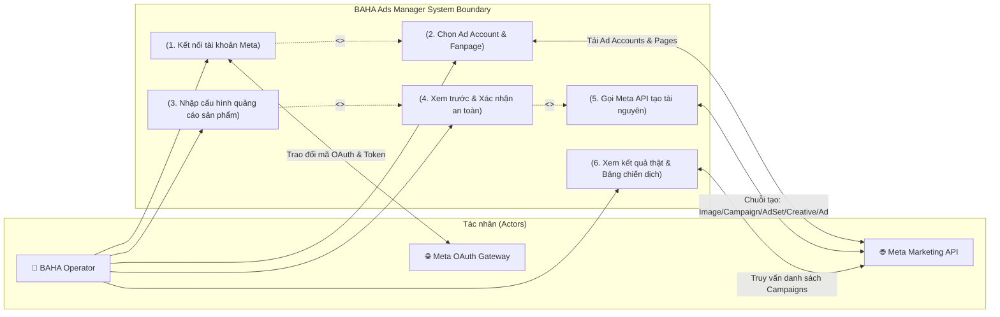
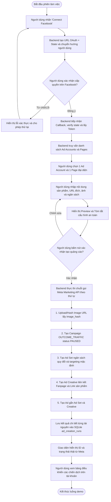

# 01. System Context & Use Case Scope — BAHA Ads Manager

**Document Layer**: Architecture Layer  
**Version**: 1.0  
**Date**: 2026-10-17  
**Status**: Living Architecture (Single Source of Truth)  

---

## 1. System Boundary & Actors

Hệ thống **BAHA Ads Manager** hoạt động như một ứng dụng web nội bộ hỗ trợ kết nối và điều phối tạo tài nguyên quảng cáo trực tiếp thông qua **Meta Graph & Marketing API**.

### 1.1. Hệ thống tác nhân (Actors)
- **👤 BAHA Demo Operator**: Người đại diện BAHA trực tiếp thao tác trên trình duyệt, sở hữu tài khoản Facebook có quyền truy cập vào Ad Account và Fanpage thử nghiệm.
- **🌐 Meta OAuth Service**: Dịch vụ xác thực danh tính và phân quyền của Facebook, cung cấp Authorization Code để backend quy đổi Access Token.
- **🌐 Meta Marketing API**: Cụm API chính thức của Meta Platforms (`v20.0`), cung cấp các endpoints tải tài sản, upload ảnh và tạo Campaign/Ad Set/Creative/Ad.
- **💾 Local SQLite Database**: Cơ sở dữ liệu cục bộ lưu trữ phiên làm việc an toàn (`meta_sessions`) và lịch sử thực thi (`ad_creation_runs`).

---

## 2. Use Case Diagram (System Boundary)

---

## 3. End-to-End Business Workflow

---

## 4. Ranh giới hệ thống (Scope Boundaries)

- **Phần mềm chịu trách nhiệm**:
  - Quản lý phiên OAuth bảo mật phía server, không để lộ Secret hay Token về phía client.
  - Kiểm tra tính hợp lệ của dữ liệu đầu vào (URL, độ lớn ngân sách, tiền tệ theo tài khoản).
  - Điều phối chuỗi 5 lời gọi Meta Marketing API tuần tự, ghi nhận chính xác kết quả từng bước (ngay cả khi xảy ra lỗi một phần - Partial Failure).
- **Phần mềm không chịu trách nhiệm**:
  - Không chịu trách nhiệm về chính sách phê duyệt bài quảng cáo hoặc xử lý tài khoản bị hạn chế thanh toán của Meta.
  - Không quản lý việc nạp tiền hoặc giải quyết tranh chấp tài khoản với Facebook.
