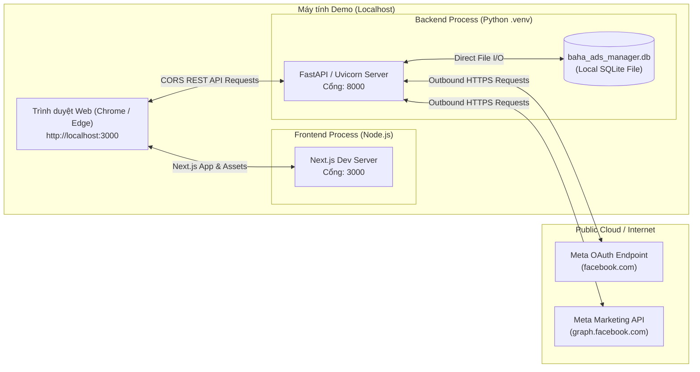

# 04. Deployment Architecture — BAHA Ads Manager

**Document Layer**: Architecture Layer  
**Status**: Living Architecture (Single Source of Truth)  
**Version**: 1.0  
**Last Updated**: 2026-10-17  

---

## 1. Deployment Topology (Local Development Mode)

Ứng dụng phục vụ mục tiêu demo nhanh trong vòng 2 giờ nên được thiết kế chạy trực tiếp trên máy trạm cục bộ (Local Host) của người thuyết trình mà không yêu cầu cài đặt Docker, Kubernetes, hay thiết lập reverse proxy Nginx phức tạp.



---

## 2. Port Allocation & Network Configuration

| Tiến trình | Công nghệ | Cổng (Port) | Ghi chú & Cấu hình |
|---|---|---|---|
| **Frontend** | Next.js (Node.js) | `3000` | URL truy cập: `http://localhost:3000` |
| **Backend** | FastAPI (Uvicorn) | `8000` | URL API: `http://localhost:8000` |
| **OAuth Callback** | FastAPI Router | `8000` | Redirect URI: `http://localhost:8000/api/meta/callback` |
| **Database** | SQLite 3 | *File-based* | Đường dẫn file: `./baha_ads_manager.db` |

---

## 3. Environment Variables Specification

Mọi cấu hình hệ thống được nạp qua tệp `.env` tại thư mục gốc backend (dựa trên mẫu `.env.example`):

```dotenv
# Meta App Credentials (Từ Meta Developer Portal)
META_APP_ID=123456789012345
META_APP_SECRET=your_app_secret_here
META_API_VERSION=v20.0

# OAuth Callback URL (Phải cấu hình đúng trong Meta App Settings)
META_REDIRECT_URI=http://localhost:8000/api/meta/callback

# Frontend URL phục vụ điều hướng sau khi OAuth hoàn tất & CORS
FRONTEND_URL=http://localhost:3000

# SQLite Database Connection String
DATABASE_URL=sqlite:///./baha_ads_manager.db
```

---

## 4. Run & Execution Guidelines

### Backend Startup:
```powershell
cd backend
# Tạo và kích hoạt môi trường ảo cục bộ
python -m venv .venv
.\.venv\Scripts\activate
# Cài đặt dependencies từ pyproject.toml hoặc requirements.txt
pip install -r requirements.txt
# Chạy Uvicorn server
uvicorn app.main:app --host 0.0.0.0 --port 8000 --reload
```

### Frontend Startup:
```powershell
cd frontend
# Cài đặt dependencies cục bộ
npm install
# Khởi chạy Next.js dev server
npm run dev
```
