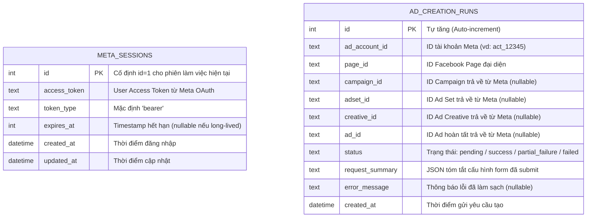

# 05. Data Architecture & Schema Invariants — BAHA Ads Manager

**Document Layer**: Architecture Layer  
**Status**: Living Architecture (Single Source of Truth)  
**Version**: 1.0  
**Last Updated**: 2026-10-17  

---

## 1. Data Design Principles

Hệ thống cơ sở dữ liệu của BAHA Ads Manager tuân thủ nguyên tắc **Tối giản có chủ đích (Deliberate Simplicity)**:
- Không mô phỏng lại toàn bộ schema phức tạp của Meta trên hệ thống nội bộ.
- Chỉ lưu trữ các thông tin thiết yếu phục vụ cho mục tiêu duy trì phiên làm việc và kiểm chứng kết quả demo end-to-end.
- Sử dụng **SQLite 3** với chế độ Write-Ahead Logging (WAL) để tối ưu hóa khả năng đọc/ghi đồng thời trong môi trường kiểm thử.

---

## 2. Entity-Relationship Diagram (ERD)

Hệ thống bao gồm 2 bảng hoàn toàn độc lập, không sử dụng foreign key phức tạp nhằm loại trừ rủi ro lock bảng khi demo:



---

## 3. Detailed Table Specifications

### 3.1. Bảng `meta_sessions`
- **Mục đích**: Lưu trữ access token của phiên OAuth, giúp người dùng không phải đăng nhập lại mỗi khi F5 trình duyệt hoặc khởi động lại backend.
- **Quy tắc bất biến**: Luôn luôn chỉ có tối đa 1 bản ghi với `id = 1`. Khi người dùng kết nối lại, hệ thống thực hiện `INSERT OR REPLACE INTO meta_sessions (id, ...) VALUES (1, ...)`.

| Cột | Kiểu dữ liệu | Ràng buộc | Mô tả |
|---|---|---|---|
| `id` | INTEGER | PRIMARY KEY | Cố định giá trị 1 cho người dùng hiện tại |
| `access_token` | TEXT | NOT NULL | Access token hợp lệ cấp từ Meta |
| `token_type` | TEXT | DEFAULT 'bearer' | Loại token |
| `expires_at` | INTEGER | NULL | Timestamp UNIX hết hạn |
| `created_at` | DATETIME | DEFAULT CURRENT_TIMESTAMP | Thời điểm tạo phiên |
| `updated_at` | DATETIME | DEFAULT CURRENT_TIMESTAMP | Thời điểm cập nhật |

### 3.2. Bảng `ad_creation_runs`
- **Mục đích**: Ghi vết lịch sử từng lần bấm tạo quảng cáo, phục vụ hiển thị kết quả gần nhất trên Dashboard và kiểm chứng ID thật.
- **Quy tắc bất biến**: Các cột ID (`campaign_id`, `adset_id`, `creative_id`, `ad_id`) bắt buộc phải là `NULLABLE` để có thể ghi nhận chính xác trường hợp thất bại một phần (Partial Failure).

| Cột | Kiểu dữ liệu | Ràng buộc | Mô tả |
|---|---|---|---|
| `id` | INTEGER | PRIMARY KEY AUTOINCREMENT | Mã định danh phiên chạy |
| `ad_account_id` | TEXT | NOT NULL | ID Ad Account chỉ định |
| `page_id` | TEXT | NOT NULL | ID Facebook Page chỉ định |
| `campaign_id` | TEXT | NULL | ID chiến dịch Meta tạo thành công |
| `adset_id` | TEXT | NULL | ID nhóm quảng cáo Meta tạo thành công |
| `creative_id` | TEXT | NULL | ID mẫu quảng cáo Meta tạo thành công |
| `ad_id` | TEXT | NULL | ID quảng cáo cuối cùng tạo thành công |
| `status` | TEXT | NOT NULL | Giá trị: `pending`, `success`, `partial_failure`, `failed` |
| `request_summary` | TEXT | NULL | Chuỗi JSON chứa tên campaign, budget, headline, url (đã loại bỏ token) |
| `error_message` | TEXT | NULL | Nội dung lỗi an toàn nếu có bước bị Meta từ chối |
| `created_at` | DATETIME | DEFAULT CURRENT_TIMESTAMP | Thời điểm thực thi |

---

## 4. DDL SQL Initialization Script

```sql
CREATE TABLE IF NOT EXISTS meta_sessions (
    id INTEGER PRIMARY KEY CHECK (id = 1),
    access_token TEXT NOT NULL,
    token_type TEXT DEFAULT 'bearer',
    expires_at INTEGER,
    created_at TIMESTAMP DEFAULT CURRENT_TIMESTAMP,
    updated_at TIMESTAMP DEFAULT CURRENT_TIMESTAMP
);

CREATE TABLE IF NOT EXISTS ad_creation_runs (
    id INTEGER PRIMARY KEY AUTOINCREMENT,
    ad_account_id TEXT NOT NULL,
    page_id TEXT NOT NULL,
    campaign_id TEXT,
    adset_id TEXT,
    creative_id TEXT,
    ad_id TEXT,
    status TEXT NOT NULL CHECK (status IN ('pending', 'success', 'partial_failure', 'failed')),
    request_summary TEXT,
    error_message TEXT,
    created_at TIMESTAMP DEFAULT CURRENT_TIMESTAMP
);

CREATE INDEX IF NOT EXISTS idx_runs_created_at ON ad_creation_runs(created_at DESC);
```
