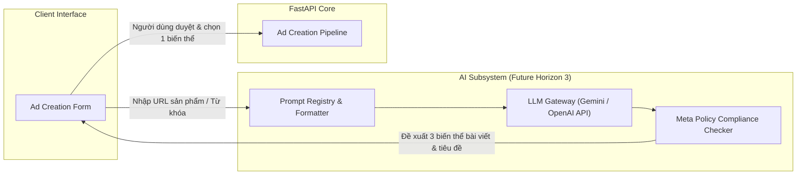

# 06. AI Architecture & Future Evolution — BAHA Ads Manager

**Document Layer**: Architecture Layer  
**Status**: Living Architecture (Single Source of Truth)  
**Version**: 1.0  
**Last Updated**: 2026-10-17  

---

## 1. MVP Status: Explicitly Out-of-Scope

Theo tài liệu [BAHA_Ads_Manager_MVP_Requirements.md](../../requirement/BAHA_Ads_Manager_MVP_Requirements.md) (Mục 2.2) và [prd.md](../../implementation/release-1/prd.md) (Mục 3.2), **các tính năng AI hoàn toàn nằm ngoài phạm vi phát triển của Release 1 (MVP Demo 2 giờ)**:
- Không sử dụng LLM để tự động sinh nội dung (copywriting).
- Không tự động sinh tiêu đề (headlines) hay văn bản quảng cáo (primary text).
- Không sử dụng mô hình học máy để tự động điều chỉnh giá thầu hay tối ưu hóa phân phối.

---

## 2. Future Architecture Blueprint (Horizon 3)

Khi hệ thống nâng cấp lên Horizon 3 (Enterprise & AI), kiến trúc phân hệ AI sẽ được tích hợp theo mô hình sau:

---

## 3. Architecture Invariants for AI Integration

Khi kích hoạt phân hệ AI trong tương lai:
1. **Human-In-The-Loop**: AI chỉ đóng vai trò hỗ trợ gợi ý (Co-pilot). Người dùng bắt buộc phải xem trước (Preview) và bấm nút xác nhận trước khi gửi dữ liệu lên Meta API.
2. **Policy Compliance**: Mọi nội dung sinh ra từ AI phải đi qua bộ lọc kiểm tra tuân thủ chính sách quảng cáo của Meta (Meta Advertising Standards).
