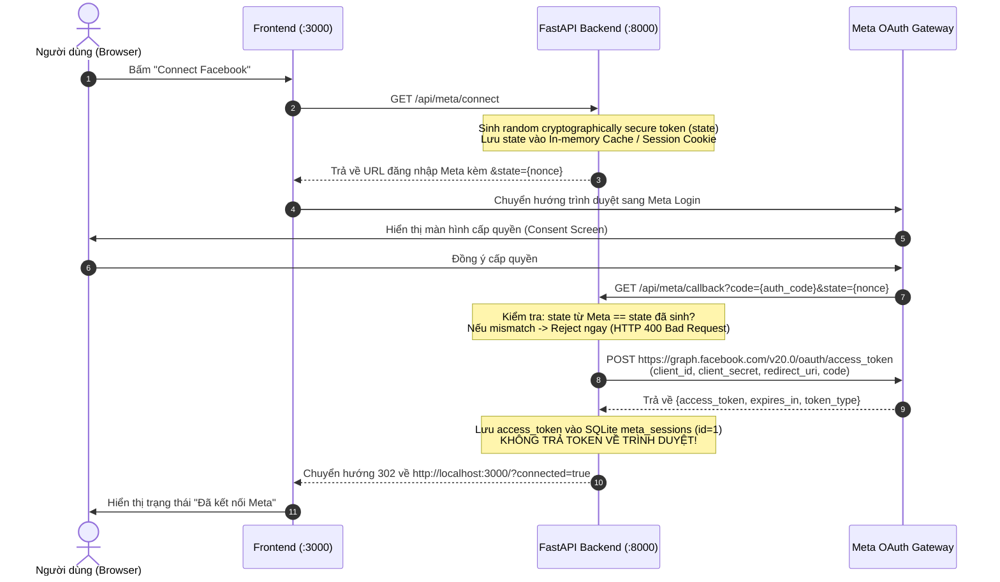

# 07. Security Architecture & Threat Model — BAHA Ads Manager

**Document Layer**: Architecture Layer  
**Status**: Living Architecture (Single Source of Truth)  
**Version**: 1.0  
**Last Updated**: 2026-10-17  

---

## 1. Security Architecture Principles

Bảo mật trong BAHA Ads Manager được xây dựng dựa trên nguyên tắc **Phòng vệ theo chiều sâu (Defense-in-Depth)** và **Cách ly tuyệt đối thông tin xác thực (Credential Isolation)**:

1. **Backend-Only Secret Possession**: `META_APP_SECRET` và User Access Token chỉ được phép tồn tại trong bộ nhớ backend và tệp cơ sở dữ liệu SQLite cục bộ.
2. **Zero Client-Side Token Exposure**: Frontend không bao giờ nhận được raw Access Token trong bất kỳ payload API response nào.
3. **Log Sanitization**: Nghiêm cấm ghi log chứa URL đầy đủ của callback OAuth (chứa authorization code) hoặc nội dung Access Token.

---

## 2. OAuth 2.0 Security Flow & CSRF Protection

Hệ thống bảo vệ quá trình ủy quyền người dùng thông qua tham số mã hóa ngẫu nhiên `state` (Cryptographic Nonce):



---

## 3. Financial Safety Invariants (Chống rủi ro chi tiêu ngoài ý muốn)

Để đảm bảo an toàn tài chính tuyệt đối trong các buổi demo trực tiếp:
- **Default Status Invariant**: Tất cả các tài nguyên quảng cáo tạo ra (Campaign, Ad Set, Ad) **bắt buộc phải có trạng thái `status: "PAUSED"`** trong payload gửi lên Meta API.
- **Explicit Confirmation Gate**: Hệ thống không cung cấp nút bấm bật `ACTIVE` hàng loạt; giao diện hiển thị cảnh báo chi tiêu nổi bật màu cam trước khi người dùng xác nhận gửi request tạo quảng cáo.
- **No Automatic Retry Storms**: Khi gặp lỗi timeout từ phía Meta sau khi đã gửi request, hệ thống **tuyệt đối không tự động retry lại request POST**, nhằm ngăn chặn việc Meta vô tình sinh ra 2 chiến dịch trùng lặp làm nhân đôi chi phí.

---

## 4. Error Sanitization & Data Masking

Khi Meta Marketing API phản hồi lỗi (ví dụ mã 100, 190, 200...):
- Backend trích xuất mã lỗi `error.code`, phân loại `error.type` và thông điệp an toàn `error.error_user_msg` (nếu có).
- Bộ lọc `sanitize_meta_error()` sẽ quét và thay thế toàn bộ chuỗi token (nếu xuất hiện) thành chuỗi `[REDACTED_TOKEN]`.
- Frontend chỉ nhận được thông báo lỗi thân thiện:
  ```json
  {
    "success": false,
    "error": {
      "code": "META_API_ERROR",
      "message": "Không thể tạo mẫu quảng cáo: URL trang đích không đáp ứng tiêu chuẩn cộng đồng của Meta."
    }
  }
  ```
