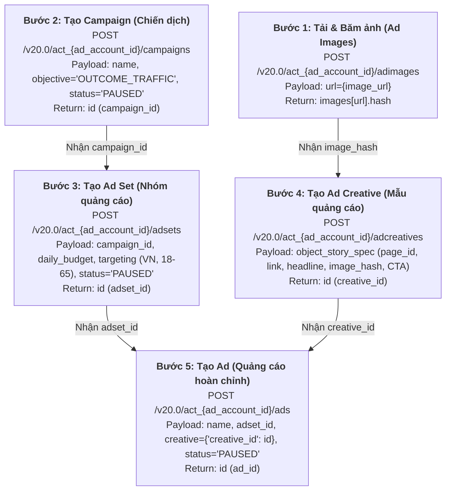

# 08. Integration Architecture & Meta Marketing API Pipeline — BAHA Ads Manager

**Document Layer**: Architecture Layer  
**Status**: Living Architecture (Single Source of Truth)  
**Version**: 1.0  
**Last Updated**: 2026-10-17  

---

## 1. External Integration Overview

BAHA Ads Manager tích hợp trực tiếp với **Meta Graph API & Marketing API v20.0** thông qua giao thức HTTPS RESTful client. 

### 1.1. Meta API Versions & Base Endpoints
- **Graph API Base URL**: `https://graph.facebook.com/v20.0`
- **OAuth Dialog Base URL**: `https://www.facebook.com/v20.0/dialog/oauth`
- **Required OAuth Scopes**:
  - `ads_management`: Quyền tạo chiến dịch, nhóm quảng cáo, creative và bài quảng cáo.
  - `ads_read`: Quyền đọc danh sách tài khoản quảng cáo và chiến dịch hiện có.
  - `pages_read_engagement`: Quyền đọc danh sách Trang Facebook mà người dùng có quyền quản lý.
  - `pages_manage_ads`: Quyền sử dụng Trang làm danh tính đại diện cho bài quảng cáo.
  - `public_profile`: Đọc thông tin định danh cơ bản của người dùng.

---

## 2. Meta Marketing API Sequential Pipeline (Chuỗi 5 bước tạo tài nguyên)

Để tạo thành công một bài quảng cáo sản phẩm trên Facebook, hệ thống phải thực thi chính xác 5 lời gọi API theo quan hệ phụ thuộc cấu trúc của Meta:



---

## 3. Concrete Payload Specifications

### 3.1. Bước 1: Ad Images
```http
POST /v20.0/act_{ad_account_id}/adimages
Content-Type: application/x-www-form-urlencoded
Authorization: Bearer {access_token}

url={image_url}
```
- Phản hồi mong đợi: `{"images": {"{image_url}": {"hash": "abc123hash..."}}}`.

### 3.2. Bước 2: Campaign
```http
POST /v20.0/act_{ad_account_id}/campaigns
Content-Type: application/json
Authorization: Bearer {access_token}

{
  "name": "BAHA Traffic Demo Campaign",
  "objective": "OUTCOME_TRAFFIC",
  "status": "PAUSED",
  "special_ad_categories": []
}
```
- Phản hồi mong đợi: `{"id": "120210000000001"}`.

### 3.3. Bước 3: Ad Set
```http
POST /v20.0/act_{ad_account_id}/adsets
Content-Type: application/json
Authorization: Bearer {access_token}

{
  "name": "BAHA Traffic Demo AdSet",
  "campaign_id": "120210000000001",
  "daily_budget": "50000",
  "billing_event": "IMPRESSIONS",
  "optimization_goal": "LINK_CLICKS",
  "bid_strategy": "LOWEST_COST_WITHOUT_CAP",
  "targeting": {
    "geo_locations": {
      "countries": ["VN"]
    },
    "age_min": 18,
    "age_max": 65
  },
  "status": "PAUSED"
}
```
- Phản hồi mong đợi: `{"id": "120210000000002"}`.

### 3.4. Bước 4: Ad Creative
```http
POST /v20.0/act_{ad_account_id}/adcreatives
Content-Type: application/json
Authorization: Bearer {access_token}

{
  "name": "BAHA Traffic Demo Creative",
  "object_story_spec": {
    "page_id": "987654321098",
    "link_data": {
      "link": "https://baha.vn/products/polo",
      "message": "Nội dung giới thiệu sản phẩm BAHA chất lượng cao.",
      "name": "Áo Polo Nam Cao Cấp BAHA",
      "image_hash": "abc123hash...",
      "call_to_action": {
        "type": "LEARN_MORE"
      }
    }
  }
}
```
- Phản hồi mong đợi: `{"id": "120210000000003"}`.

### 3.5. Bước 5: Ad
```http
POST /v20.0/act_{ad_account_id}/ads
Content-Type: application/json
Authorization: Bearer {access_token}

{
  "name": "BAHA Traffic Demo Ad",
  "adset_id": "120210000000002",
  "creative": {
    "creative_id": "120210000000003"
  },
  "status": "PAUSED"
}
```
- Phản hồi mong đợi: `{"id": "120210000000004"}`.

---

## 4. Currency Conversion Invariant (Quy tắc chuyển đổi tiền tệ D-06)

Quy định xử lý trường `daily_budget`:
```python
def format_meta_budget(amount: float, currency: str) -> str:
    """
    Quy đổi ngân sách gửi lên Meta Marketing API:
    - Tiền tệ có cent (USD, EUR, GBP, SGD, CAD, AUD,...): nhân 100.
    - Tiền tệ không có cent (VND, JPY, KRW,...): giữ nguyên số nguyên.
    """
    ZERO_DECIMAL_CURRENCIES = {"VND", "JPY", "KRW", "CLP", "PYG", "UGX"}
    curr = currency.upper()
    if curr in ZERO_DECIMAL_CURRENCIES:
        return str(int(amount))
    return str(int(amount * 100))
```

---

## 5. System-Wide API Standards & Consistent Response Envelope (Pattern 7)

Mọi API nội bộ do backend cung cấp đều tuân thủ chặt chẽ cấu trúc phong bì nhất quán (Consistent Envelope Pattern):

### 5.1. Success Envelope (`200 OK`, `201 Created`)
```json
{
  "success": true,
  "statusCode": 200,
  "message": "Thao tác thành công",
  "data": {},
  "meta": {
    "timestamp": "2026-10-17T14:50:00Z",
    "requestId": "req_1a2b3c4d5e"
  }
}
```

### 5.2. Error Envelope (`400`, `401`, `404`, `422`, `500`)
```json
{
  "success": false,
  "statusCode": 400,
  "message": "Mô tả lỗi an toàn và dễ hiểu cho người dùng",
  "error": {
    "code": "ERROR_CODE_UPPERCASE",
    "details": []
  },
  "meta": {
    "timestamp": "2026-10-17T14:50:00Z",
    "requestId": "req_1a2b3c4d5e"
  }
}
```
