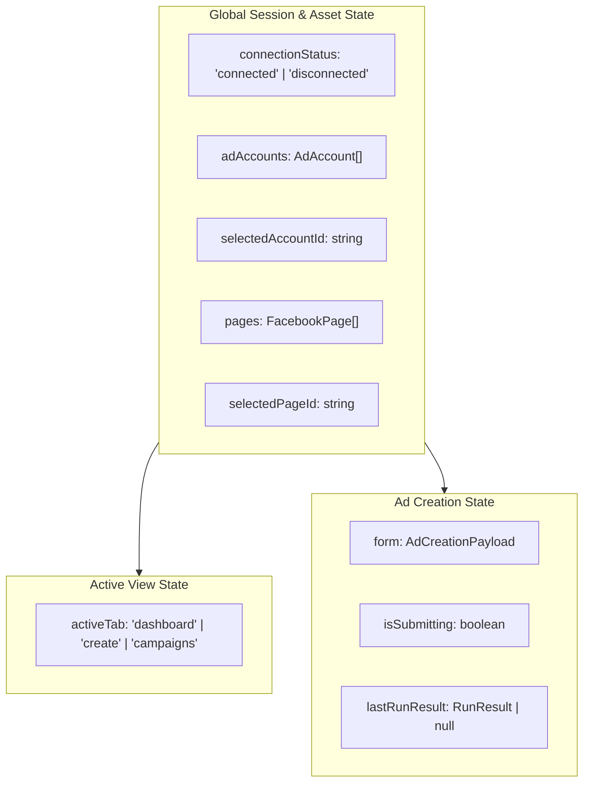

# 13. Frontend Architecture & State Management — BAHA Ads Manager

**Document Layer**: Architecture Layer  
**Status**: Living Architecture (Single Source of Truth)  
**Version**: 1.0  
**Last Updated**: 2026-10-17  

---

## 1. State Management Architecture

Ứng dụng sử dụng mô hình quản lý trạng thái tập trung gọn nhẹ dựa trên **React Built-in State Hooks (`useState`, `useEffect`)** hoặc **SWR (Stale-While-Revalidate)**, loại bỏ hoàn toàn sự phức tạp của Redux Toolkit hay Zustand:



---

## 2. API Communication Layer (`frontend/src/services/api.ts`)

Mọi giao tiếp HTTP từ client sang backend FastAPI được đóng gói thành một singleton API client sử dụng `fetch` tiêu chuẩn:

- **Base URL**: Tự động nhận diện từ `process.env.NEXT_PUBLIC_API_URL || 'http://localhost:8000'`.
- **Response Unwrapping**: Tự động giải nén envelope `data` và ném exception nếu `success === false`.
- **Error Propagation**: Chuẩn hóa thông điệp lỗi để hiển thị trực tiếp lên UI Toast/Alert.

```typescript
// Các phương thức cốt lõi:
export const api = {
  getHealth: () => request('/api/health'),
  getMetaStatus: () => request('/api/meta/status'),
  getAdAccounts: () => request('/api/meta/ad-accounts'),
  getPages: () => request('/api/meta/pages'),
  getCampaigns: (adAccountId: string) => request(`/api/campaigns?ad_account_id=${adAccountId}`),
  createAd: (payload: CreateAdPayload) => request('/api/ads', { method: 'POST', body: JSON.stringify(payload) }),
};
```
