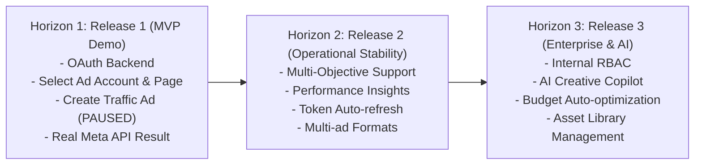

# Product Roadmap — BAHA Ads Manager

**Document Layer**: Business Layer  
**Version**: 1.0  
**Date**: 2026-10-17  
**Status**: Active  

---

## 1. Phân kỳ lộ trình phát triển (Horizons)

---

## 2. Chi tiết các cột mốc phát hành (Release Milestones)

### Release 1 (MVP Demo) — *Giai đoạn hiện tại*
- **Trọng tâm**: Hoàn thành luồng demo end-to-end có thể chạy kiểm chứng trong vòng 2 giờ.
- **Năng lực cốt lõi**:
  - Kết nối Meta OAuth với cơ chế chống CSRF bằng `state`.
  - Truy vấn danh sách thật Ad Account và Fanpage từ Meta Graph API `v20.0`.
  - Form tạo quảng cáo chuẩn hóa cho 1 mục tiêu duy nhất: `OUTCOME_TRAFFIC` và định dạng `Single Image Link Ad`.
  - Quy đổi tiền tệ tự động theo đơn vị tài khoản (cent vs integer).
  - Chuỗi API tạo 5 tài nguyên: Image Hash -> Campaign -> Ad Set -> Ad Creative -> Ad (mặc định trạng thái `PAUSED`).
  - Ghi nhận và hiển thị ID, trạng thái hoặc thông báo lỗi thật từ Meta.
  - SQLite lưu session đăng nhập và lịch sử phiên chạy `ad_creation_runs`.

---

### Release 2 (Operational Stability) — *Giai đoạn kế tiếp*
- **Trọng tâm**: Nâng cấp tính ổn định, hỗ trợ đa định dạng quảng cáo và báo cáo hiệu quả.
- **Năng lực dự kiến**:
  - Bổ sung các mục tiêu chiến dịch khác: `OUTCOME_LEADS` (Thu thập khách hàng tiềm năng), `OUTCOME_ENGAGEMENT` (Tương tác).
  - Hỗ trợ định dạng Carousel Ad và Video Ad.
  - Bảng điều khiển Meta Insights: Spend, Impressions, Reach, Clicks, CPC, CTR.
  - Cơ chế tự động gia hạn Long-lived User Access Token (60 ngày).
  - Chức năng Bật/Tắt (Pause/Resume) trực tiếp chiến dịch từ ứng dụng.

---

### Release 3 (Enterprise & Scale) — *Tương lai*
- **Trọng tâm**: Quản trị doanh nghiệp, đa người dùng và trí tuệ nhân tạo.
- **Năng lực dự kiến**:
  - Hệ thống xác thực nội bộ và phân quyền vai trò (Admin, Media Buyer, Viewer).
  - AI Assistant tự động đề xuất tiêu đề, nội dung quảng cáo và phân tích tệp khách hàng.
  - Quản lý thư viện Asset số (Digital Asset Management - DAM) đồng bộ với Meta Media Library.
  - Tự động tối ưu ngân sách theo quy tắc đặt trước (Rule-based budget adjustments).
