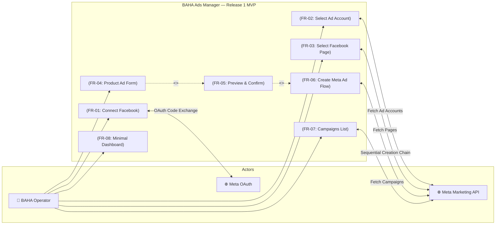
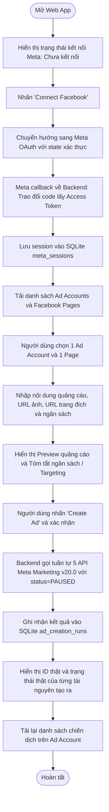

# Product Requirements Document (PRD) — Release 1: MVP Demo

**Document Layer**: Implementation Layer  
**Release**: release-1 (MVP Demo)  
**Version**: 1.0  
**Created Date**: 2026-10-17  
**Author**: Senior IT-BA & PO  
**Status**: Approved  
**Quality Score**: 100/100  

---

## 1. Release Goals & Business Context

### 1.1. Release Goals
- **Tham chiếu Business Layer**: Bám sát mục tiêu chiến lược tại [brd.md](../../business/brd.md) và lộ trình tại [roadmap.md](../../business/roadmap.md).
- **Vấn đề giải quyết trong Release này**: Xây dựng một ứng dụng web full-stack có thể demo trong khoảng **2 giờ**, dùng để kết nối Meta/Facebook, chọn tài khoản quảng cáo và Fanpage, tạo quảng cáo sản phẩm qua **Meta Marketing API chính thức**, và hiển thị kết quả thật (ID, status).
- **Ưu tiên tuyệt đối**: Một luồng demo end-to-end chạy được. Không xây sản phẩm hoàn chỉnh, không làm tính năng phụ, không giả lập kết quả API thật.

### 1.2. Success Metrics & KPIs
| Chỉ số (KPI) | Mục tiêu Release 1 | Phương thức kiểm tra |
|---|---|---|
| **End-to-End Execution** | 100% hoàn thành luồng tạo quảng cáo | Có bản ghi thành công trong SQLite `ad_creation_runs` |
| **API Data Authenticity** | 100% dữ liệu từ Meta Marketing API | Response trả về có ID thật từ Meta (`campaign_id`, `adset_id`, `creative_id`, `ad_id`) |
| **Safety Invariant** | 100% chiến dịch tạo ra ở trạng thái `PAUSED` | Trường status gửi lên Meta và lưu DB luôn là `PAUSED` |
| **Security Leakage** | 0 trường hợp rò rỉ token / secret | Không có access token hoặc App Secret trong response frontend hoặc console log |

---

## 2. Target Personas for this Release

### Persona: BAHA Demo Operator
- **Vai trò**: Người đại diện BAHA thao tác trực tiếp trên giao diện trong buổi demo.
- **Mục tiêu trong Release**:
  1. Đăng nhập kết nối Facebook bằng tài khoản do BAHA cung cấp.
  2. Lựa chọn đúng Ad Account và Facebook Page thử nghiệm.
  3. Nhập thông tin sản phẩm và nhấn nút tạo quảng cáo.
  4. Quan sát kết quả thật trả về và danh sách chiến dịch trên Ad Account.
- **Điểm nghẽn cần tránh**: Giao diện phức tạp gây chậm trễ, token bị mất khi reload trang, hoặc chi phí quảng cáo tự kích hoạt.

---

## 3. Scope & System Boundary

### 3.1. Use Case Diagram

### 3.2. Scope Definition

#### In-Scope (Cam kết bàn giao trong Release 1)
- Giao diện Next.js + Tailwind CSS chạy cục bộ trên máy demo.
- Backend FastAPI điều phối toàn bộ lời gọi Meta API từ phía server.
- Tích hợp OAuth 2.0 của Meta với xác thực tham số `state` chống CSRF.
- Tải danh sách thật Ad Account và Facebook Page từ token hiện tại.
- Biểu mẫu tạo quảng cáo sản phẩm với 1 mục tiêu cố định: `OUTCOME_TRAFFIC` và 1 định dạng: `Single Image Link Ad`.
- Cơ chế quy đổi tiền tệ theo Ad Account (nhân 100 cho tiền có cent, giữ nguyên số nguyên cho VND/JPY).
- Trình xem trước (Preview) nội dung và cảnh báo an toàn ngân sách trước khi submit.
- Gọi chuỗi 5 API tuần tự: Upload/Hash ảnh -> Campaign -> Ad Set -> Creative -> Ad (mặc định `PAUSED`).
- Lưu trữ SQLite: bảng `meta_sessions` (lưu token duy trì phiên) và bảng `ad_creation_runs` (lịch sử tạo tài nguyên).
- Hiển thị kết quả thật: resource IDs, trạng thái, mã lỗi chi tiết nếu thất bại một phần (Partial Failure).
- Danh sách chiến dịch từ Ad Account và Dashboard tối giản.
- Hướng dẫn cấu hình môi trường `.env.example` và README kiểm tra demo.

#### Out-of-Scope (Tuyệt đối không làm trong Release 1)
- Hệ thống tài khoản người dùng nội bộ riêng biệt (Local user login / Sign up).
- Phân quyền nhiều vai trò (Multi-role RBAC), quản lý đa tổ chức.
- Tích hợp cổng thanh toán, hóa đơn, quản lý thẻ tín dụng.
- Phân tích chỉ số nâng cao (Insights chi tiết, biểu đồ lọc đa chiều).
- AI viết nội dung quảng cáo, A/B Testing, tự động hóa quy tắc giá thầu.
- Lập lịch đăng quảng cáo, tải file video/ảnh đa phương tiện multipart.
- Tạo tài khoản quảng cáo mới từ ứng dụng.
- Dữ liệu mẫu (mock) giả dạng kết quả tích hợp thật.

---

## 4. Core Workflows

### 4.1. Luồng nghiệp vụ chính (Happy Path)

---

## 5. Functional Requirements & Business Rules

| ID | Tên tính năng | Mô tả nghiệp vụ | Quy tắc nghiệp vụ (Business Rules) | Mức ưu tiên |
|---|---|---|---|:---:|
| **FR-01** | **Kết nối Facebook** | Đăng nhập tài khoản Meta qua OAuth 2.0 | Backend tạo URL chứa tham số `state` ngẫu nhiên để chống CSRF. Xử lý code exchange tại server. Lưu token vào `meta_sessions` (1 record). Tuyệt đối không trả token hoặc Secret về frontend. | **P0** |
| **FR-02** | **Chọn Ad Account** | Tải danh sách tài khoản quảng cáo người dùng có quyền | Gọi `GET /me/adaccounts`. Hiển thị ID, tên, currency. Bắt buộc chọn 1 tài khoản trước khi tạo quảng cáo. Backend kiểm tra tính hợp lệ của account ID. | **P0** |
| **FR-03** | **Chọn Facebook Page** | Tải danh sách Fanpage có thể đại diện quảng cáo | Gọi `GET /me/accounts`. Hiển thị ID và tên Page. Nếu không có Page, hiển thị hướng dẫn kiểm tra quyền quản lý Page. | **P0** |
| **FR-04** | **Form tạo quảng cáo sản phẩm** | Nhập thông tin tối thiểu cho chiến dịch | - Mục tiêu cố định: `OUTCOME_TRAFFIC` - Định dạng: `Single Image Link Ad` - Trạng thái mặc định: `PAUSED` - Loại ngân sách: `daily_budget` - Quy đổi tiền tệ: Ad Account USD/EUR nhân 100, VND giữ nguyên số nguyên. - Targeting mặc định: Toàn quốc VN, 18-65 tuổi, all genders. - CTA cố định: `LEARN_MORE`. | **P0** |
| **FR-05** | **Preview & Xác nhận** | Xem trước bài quảng cáo trước khi submit | Hiển thị mô phỏng bài quảng cáo gồm Headline, Primary text, Ảnh, Link đích, nút CTA, và tóm tắt ngân sách/targeting. Yêu cầu nhấn nút xác nhận tường minh. Cảnh báo an toàn không tự bật chi tiêu. | **P0** |
| **FR-06** | **Tạo quảng cáo qua Meta Marketing API** | Thực thi chuỗi 5 API calls tuần tự từ Backend | Thứ tự tạo: 1. `POST /act_{id}/adimages` lấy `image_hash` 2. `POST /act_{id}/campaigns` 3. `POST /act_{id}/adsets` 4. `POST /act_{id}/adcreatives` 5. `POST /act_{id}/ads` Nếu lỗi tại bước N, ghi nhận ID các bước trước và báo lỗi chính xác bước N (Partial Failure). Không tự động retry khi chưa rõ kết quả. | **P0** |
| **FR-07** | **Danh sách chiến dịch** | Hiển thị các chiến dịch trên Ad Account | Gọi `GET /act_{id}/campaigns`. Hiển thị Tên, ID, Objective, Status và thời điểm tạo. Có nút Refresh tải dữ liệu mới. Không hiển thị dữ liệu giả. | **P0** |
| **FR-08** | **Dashboard tối giản** | Trang tổng quan trạng thái vận hành | Hiển thị trạng thái kết nối Meta, Ad Account/Page đang chọn, số lượng chiến dịch và kết quả phiên tạo quảng cáo gần nhất. | **P0** |
| **FR-09** | **Trạng thái tải & Xử lý lỗi** | Quản lý trải nghiệm khi gọi API | Cung cấp Loading, Error, Empty states rõ ràng. Disable nút submit trong lúc đang gửi request để chống double-click. Giữ lại dữ liệu form khi có lỗi. | **P0** |

---

## 6. Architecture Guardrails for Release 1

> ⛔ **Nguyên tắc bất biến bắt buộc**: Lập trình viên và AI Coding Agent khi thực thi code cho Release 1 phải tuân thủ nghiêm ngặt các tài liệu kiến trúc sau:

1. **Data Architecture Compliance**:
   - Tuân thủ cấu trúc 2 bảng SQLite tối giản theo [05-data-architecture.md](../../architecture/05-data-architecture.md): `meta_sessions` và `ad_creation_runs`.
   - Tuyệt đối không tự ý thêm các bảng phức tạp hoặc thay đổi cấu trúc lưu trữ đã định nghĩa.
2. **Security & Credential Protection**:
   - Tuân thủ chính sách bảo mật tại [07-security-architecture.md](../../architecture/07-security-architecture.md).
   - `META_APP_SECRET` và access tokens chỉ tồn tại trong backend environment và cơ sở dữ liệu SQLite cục bộ.
   - Không log URL chứa authorization code hoặc access token.
3. **Design Principles & Clean Architecture**:
   - Tuân thủ quy chuẩn mã nguồn trong [09-design-principles.md](../../architecture/09-design-principles.md).
   - Tách biệt rõ ràng tầng Controller (FastAPI Routers), Service (Meta Client, Token Service) và Repository (SQLite DB).
4. **Folder Structure Invariant**:
   - Tuân thủ cấu trúc thư mục quy chuẩn tại [10-folder-structure.md](../../architecture/10-folder-structure.md).

---

## 7. Open Questions & Technical Decisions Log

Các quyết định kỹ thuật trọng yếu đã được chốt qua thẩm định (Technical Decisions Log):

| Mã | Hạng mục quyết định | Nội dung đã chốt | Trạng thái |
|---|---|---|:---:|
| `D-01` | **Mục tiêu & Định dạng** | Mục tiêu: `OUTCOME_TRAFFIC`, Định dạng: `Single Image Link Ad`, Trạng thái mặc định: `PAUSED`. | `[x] Resolved` |
| `D-02` | **Xử lý ảnh Creative** | Người dùng nhập URL ảnh công khai; Backend gọi `POST /adimages` lấy `image_hash`. | `[x] Resolved` |
| `D-03` | **Targeting mặc định** | Toàn quốc Việt Nam (VN), độ tuổi 18–65, giới tính Tất cả. | `[x] Resolved` |
| `D-04` | **Chế độ Meta App & Redirect** | Development Mode, Redirect URI: `http://localhost:8000/api/meta/callback`. | `[x] Resolved` |
| `D-05` | **Quản lý Token Session** | Bảng SQLite `meta_sessions` (duy trì 1 phiên đăng nhập hợp lệ). | `[x] Resolved` |
| `D-06` | **Quy đổi Ngân sách** | Backend tự quy đổi theo currency của Ad Account (nhân 100 với USD/EUR; giữ nguyên với VND). | `[x] Resolved` |

---

## 8. Handoff Plan & Next Steps

1. **Handoff sang Kiến trúc kỹ thuật (`system-design`)**:
   - Cập nhật chi tiết các tài liệu kiến trúc tại `docs/architecture/` (`02-high-level-architecture.md`, `03-service-architecture.md`, `04-deployment-architecture.md`, `05-data-architecture.md`, `07-security-architecture.md`, `adr/ADR-001.md`).
   - Xây dựng tài liệu thiết kế kỹ thuật chi tiết tại `docs/implementation/release-1/technical-design.md`.
2. **Handoff sang Thiết kế API (`api-design-patterns`)**:
   - Xây dựng tài liệu đặc tả API v1 chuẩn mực tại `docs/implementation/release-1/api/v1.md`.
3. **Handoff sang Phân rã Backlog (`user-story-ac-writer`)**:
   - Tạo sổ cái User Story tại `docs/implementation/release-1/backlog/story-index.md`.
   - Sinh chi tiết các User Stories kèm Given-When-Then Acceptance Criteria và Architecture Guardrails trong `docs/implementation/release-1/backlog/stories/`.
