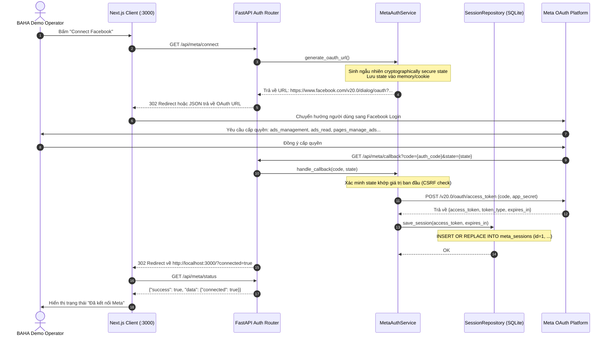
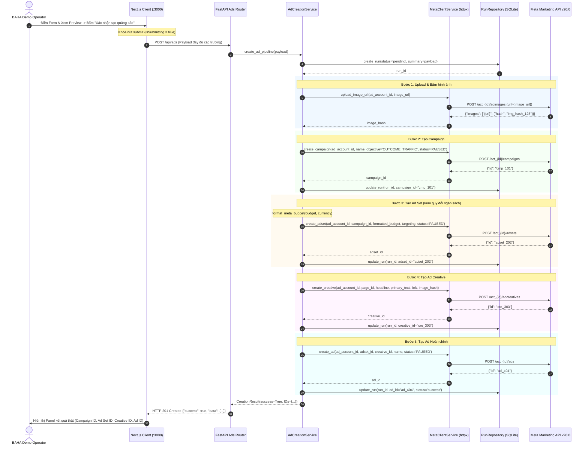

# Technical Design Document — Release 1: MVP Demo

**Tầng tài liệu**: Implementation Layer  
**Release**: release-1 (MVP Demo)  
**Tài liệu tham chiếu**: [prd.md](prd.md), [02-high-level-architecture.md](../../architecture/02-high-level-architecture.md), [08-integration-architecture.md](../../architecture/08-integration-architecture.md)  
**Ngày phê duyệt**: 2026-10-17  
**Trạng thái**: Approved  

---

## 1. Subsystem Scope & Technical Goals

Tài liệu này đặc tả chi tiết kiến trúc kỹ thuật nội bộ của **Release 1 (MVP Demo)**, tập trung vào hai luồng nghiệp vụ xương sống:
1. **Luồng Xác thực & Kết nối Tài sản (Auth & Asset Ingestion Flow)**.
2. **Luồng Điều phối Tạo Quảng cáo Tuần tự (Sequential Ad Creation Flow)**.

---

## 2. Detailed Technical Sequence Diagrams

### 2.1. Luồng Xác thực OAuth 2.0 & Duy trì Phiên


---

### 2.2. Luồng Điều phối Chuỗi 5 Lời gọi Meta Marketing API


---

## 3. Partial Failure Handling & Recovery Flow

Nếu xảy ra lỗi tại bất kỳ bước nào trong chuỗi 5 bước (ví dụ: bước 4 tạo Creative bị lỗi do link đích bị Meta chặn):
1. `AdCreationService` bắt exception cụ thể từ `MetaClient`.
2. Trích xuất mã lỗi và thông báo lỗi đã được làm sạch qua `sanitize_meta_error()`.
3. Cập nhật bản ghi `ad_creation_runs` với `status = 'partial_failure'`, lưu lại các ID đã tạo thành công trước đó (ví dụ: `campaign_id` và `adset_id`) và lưu `error_message`.
4. Trả về HTTP 207 Multi-Status hoặc HTTP 400 kèm chi tiết:
   ```json
   {
     "success": false,
     "status": "partial_failure",
     "created_resources": {
       "campaign_id": "120210000000001",
       "adset_id": "120210000000002",
       "creative_id": null,
       "ad_id": null
     },
     "failed_step": "create_creative",
     "error": {
       "code": "META_CREATIVE_POLICY_VIOLATION",
       "message": "Trang đích sản phẩm không thể truy cập hoặc vi phạm tiêu chuẩn Meta."
     }
   }
   ```
5. Giao diện hiển thị rõ ràng các tài nguyên đã tạo, bước bị lỗi, và **tuyệt đối không tự động retry**.
